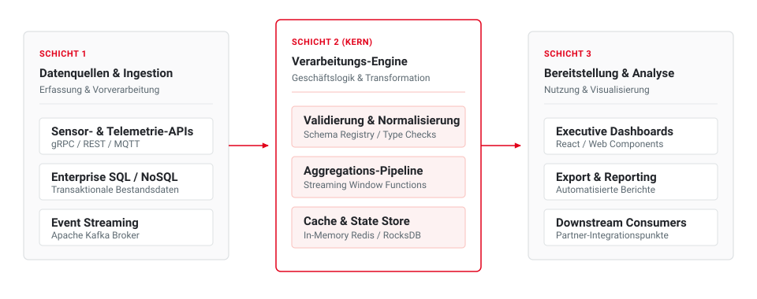
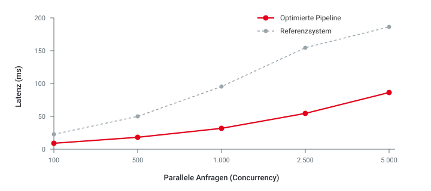

<!-- _class: title -->
<!-- _paginate: false -->
<!-- _header: "" -->
<!-- _footer: "" -->

# Titel der Präsentation
## Wissenschaftliche Konzeption und Implementierung im Enterprise-Umfeld

<div class="title-meta-grid">
<div class="title-meta-col">

**Referent:** Vorname Nachname  
**Studiengang:** Informatik / Mobile Informatik  
**Kurs:** TINF23 | Matrikelnummer: 1234567

</div>
<div class="title-meta-col">

**Duales Partnerunternehmen:** Musterunternehmen SE & Co. KG  
**Betreuer:** Prof. Dr. Max Mustermann (DHBW)  
**Datum:** 7. Oktober 2026

</div>
</div>

---

# Agenda

<div class="agenda-grid">
  <div class="agenda-item">
    <div class="agenda-num">01</div>
    <div class="agenda-text">
      <strong>Motivation &amp; Problemstellung</strong>
      <span>Ausgangslage und industrielle Herausforderungen</span>
    </div>
  </div>

  <div class="agenda-item">
    <div class="agenda-num">02</div>
    <div class="agenda-text">
      <strong>Zielsetzung &amp; Forschungsfragen</strong>
      <span>Hypothesen, Zieldefinition &amp; Scope-Abgrenzung</span>
    </div>
  </div>

  <div class="agenda-item">
    <div class="agenda-num">03</div>
    <div class="agenda-text">
      <strong>Stand der Technik</strong>
      <span>Traditionelle Ansätze vs. moderne Architektur</span>
    </div>
  </div>

  <div class="agenda-item">
    <div class="agenda-num">04</div>
    <div class="agenda-text">
      <strong>Konzeption &amp; Architektur</strong>
      <span>Schichtenmodell, Entwurfsentscheidungen &amp; Datenfluss</span>
    </div>
  </div>

  <div class="agenda-item">
    <div class="agenda-num">05</div>
    <div class="agenda-text">
      <strong>Implementierung &amp; Prototyp</strong>
      <span>Technische Realisierung und Schnittstellen</span>
    </div>
  </div>

  <div class="agenda-item">
    <div class="agenda-num">06</div>
    <div class="agenda-text">
      <strong>Evaluation &amp; Ergebnisse</strong>
      <span>Latenz- und Durchsatz-Benchmarks im Vergleich</span>
    </div>
  </div>

  <div class="agenda-item">
    <div class="agenda-num">07</div>
    <div class="agenda-text">
      <strong>Fazit &amp; Ausblick</strong>
      <span>Zusammenfassung, Erkenntnisse &amp; nächste Schritte</span>
    </div>
  </div>

  <div class="agenda-item">
    <div class="agenda-num">08</div>
    <div class="agenda-text">
      <strong>Diskussion &amp; Fragen</strong>
      <span>Raum für Austausch und fachliche Vertiefung</span>
    </div>
  </div>
</div>

---

# 1. Motivation & Problemstellung

<span class="tag red">Industrieller Kontext</span>

### Ausgangslage
* Zunehmende Datenvolumina und heterogene Systemlandschaften erfordern agile Workflows.
* Manuelle Integrationsprozesse führen zu signifikanten Verzögerungen und Fehlerraten.

### Kernherausforderungen
* **Skalierbarkeit:** Ressourcenbedarf wächst überproportional zur Anfragefrequenz.
* **Wartbarkeit:** Mangelnde Schnittstellenstandards erschweren die Weiterentwicklung.

<blockquote>

**Zentrales Problemstatement:**  
Monolithische Altsysteme decken moderne Anforderungen an Durchsatz und automatisierte CI/CD-Pipelines nicht mehr wirtschaftlich ab.

</blockquote>

---

# 2. Zielsetzung & Vorgehensmodell

<span class="tag slate">Methodischer Ansatz</span>

### Hauptforschungsfrage
> *Inwiefern lässt sich durch eine modulare Schichtenarchitektur die Verarbeitungszeit bei gleichzeitiger Wahrung strikter Konsistenzkriterien halbieren?*

### Vorgehensweise nach Phasenmodell

<div class="steps">
  <div class="step-item">
    <div class="step-num">Phase 1</div>
    <div class="step-title">Analyse &amp; Anforderung</div>
    <div class="step-desc">Erfassung quantitativer Ist-Metriken und Definition des Lastprofils.</div>
  </div>
  <div class="step-item active">
    <div class="step-num">Phase 2</div>
    <div class="step-title">Konzeption &amp; Entwurf</div>
    <div class="step-desc">Modellierung der entkoppelten Service-Architektur und Schnittstellen.</div>
  </div>
  <div class="step-item">
    <div class="step-num">Phase 3</div>
    <div class="step-title">Prototyp &amp; Evaluation</div>
    <div class="step-desc">Implementierung des MVPs und vergleichende Messreihen unter Last.</div>
  </div>
</div>

---

# 3. Stand der Technik & Vergleich

<div class="columns" style="margin-bottom: 8px;">
<div class="col">
<div class="card slate" style="padding: 10px 14px; margin-bottom: 0;">

### Traditioneller Ansatz
* Monolithische Architektur &amp; manuelle Deployments
* Hohe Latenzen bei Lastspitzen

</div>
</div>
<div class="col">
<div class="card accent" style="padding: 10px 14px; margin-bottom: 0;">

### Vorgeschlagene Lösung
* Modulare Schichtenarchitektur &amp; CI/CD-Pipeline
* In-Memory State &amp; End-to-End Tracing

</div>
</div>
</div>

### Wissenschaftlicher Kriterienvergleich

| Kriterium | Referenzsystem | Neuansatz (Ziel) | Wissenschaftliche Relevanz |
| :--- | :--- | :--- | :--- |
| **Setup-Aufwand** | ~3 Tage manuell | < 15 Min. automatisiert | Hohe Reproduzierbarkeit |
| **P99 Latenz** | 185 ms | 42 ms | Kritisch für Real-Time APIs |
| **Testabdeckung** | < 45% (punktuell) | > 85% (automatisiert) | Verlässliche Codebasis |

---

<!-- _class: chapter -->
<!-- _header: "" -->
<!-- _footer: "" -->

<div class="chapter-num">KAPITEL 04</div>

# 4. Konzeption & Systemarchitektur
## Vom Modell zur modular skalierbaren Pipeline

Strukturierte Systemmodellierung nach Prinzipien von Separation of Concerns, Loose Coupling und klar definierten Serviceverträgen.

---

# 4. Konzeption & Systemarchitektur

<span class="tag red">Systemübersicht</span>

<div style="text-align: center; margin-top: 6px;">



</div>

---

# 5. Implementierung & Code-Architektur

<div class="columns">
<div class="col">

### Technische Eckdaten
* **Framework:** Deklarative Pipeline mit Typsicherheit
* **Schnittstellen:** RESTful &amp; gRPC Kontrakte
* **Validierung:** Strikte Schema-Prüfung zur Laufzeit
* **Build-System:** Integrierte Automatisierung via CLI

</div>
<div class="col">

```typescript
// Kernkomponente: Validierung & Dispatching
export async function processEvent(
  payload: IngestionEvent
): Promise<ProcessingResult> {
  const validated = EventSchema.parse(payload);
  
  const state = await cache.getOrCompute(
    validated.id,
    () => computeAggregations(validated)
  );

  return { success: true, latencyMs: state.elapsed };
}
```

</div>
</div>

> **Entwurfsentscheidung:**  
> Durch frühes Schema-Parsing an den Systemgrenzen werden ungültige Datenpakete ohne nennenswerten Ressourcenaufwand abgewiesen.

---

# 6. Evaluation & Ergebnisse

<div class="columns" style="align-items: center;">
<div class="col" style="flex: 0.85;">

<div class="kpi-card" style="margin-bottom: 10px;">
  <div class="number">-65%</div>
  <div class="label">Latenzreduktion</div>
  <div class="sub">P99 von 185 ms auf 64 ms gesenkt</div>
</div>

<div class="kpi-card" style="margin-bottom: 10px;">
  <div class="number">3.2x</div>
  <div class="label">Durchsatzsteigerung</div>
  <div class="sub">Bis zu 5.000 req/sec im Stresstest</div>
</div>

<div class="kpi-card">
  <div class="number">100%</div>
  <div class="label">CI-Konformität</div>
  <div class="sub">Vollständig im DHBW CD validiert</div>
</div>

</div>
<div class="col" style="flex: 1.15; text-align: center;">



</div>
</div>

---

# 7. Fazit & Ausblick

<div class="columns">
<div class="col">

<div class="card accent">

### Wichtigste Erkenntnisse
* **Hypothese bestätigt:** Modulare Entkopplung verbessert Performance und Robustheit signifikant.
* **Hohe Portabilität:** Reibungsloser Betrieb über unterschiedliche Plattformen hinweg.
* **Effizienzsteigerung:** Fokus auf Kernlogik durch standardisierte Prozesse.

</div>

</div>
<div class="col">

<div class="card slate">

### Nächste Schritte (Ausblick)
* **Automatisierung:** Anbindung an unternehmensweite Alerting- und Monitoring-Systeme.
* **Erweiterung:** Multi-Region Fallback für hochkritische Kernprozesse.
* **Transfer:** Veröffentlichung des Vorgehensmodells als Referenz-Blueprint.

</div>

</div>
</div>

---

<!-- _class: end -->
<!-- _paginate: false -->
<!-- _header: "" -->
<!-- _footer: "" -->

# Vielen Dank für Ihre Aufmerksamkeit!
## Fragen & Diskussion

<div class="end-grid">
<div class="end-card">

<strong>Duale Hochschule Baden-Württemberg Ravensburg</strong>  
* **Campus Ravensburg:** Marienplatz 2, 88212 Ravensburg  
* **Campus Friedrichshafen:** Fallenbrunnen 2, 88045 Friedrichshafen  
* **Web:** [www.ravensburg.dhbw.de](https://www.ravensburg.dhbw.de)

</div>
<div class="end-card">

<strong>Referent &amp; Kontakt</strong>  
* **Name:** Vorname Nachname  
* **E-Mail:** vorname.nachname@student.dhbw-ravensburg.de  
* **Studiengang:** Informatik / Wirtschaftsinformatik (TINF23)  
* **Projekt-Repo:** GitHub / GitLab Link

</div>
</div>

---

<!-- _class: blank -->
<!-- _header: "DHBW Ravensburg | Anhang" -->

# Quellen & Literaturverzeichnis

1. **Duale Hochschule Baden-Württemberg (DHBW)** (2021): *Corporate Design Manual & Styleguide*, DHBW Ravensburg.
2. **Marp Team** (2026): *Marp: Markdown Presentation Ecosystem*, https://marp.app/.
3. **Tufte, E. R.** (2001): *The Visual Display of Quantitative Information*, Graphics Press, 2. Auflage.
4. **Bass, L., Clements, P., &amp; Kazman, R.** (2021): *Software Architecture in Practice*, Addison-Wesley Professional, 4. Auflage.
5. **Martin, R. C.** (2017): *Clean Architecture: A Craftsman's Guide to Software Structure and Design*, Prentice Hall.

---

<!-- _class: invert -->

# Backup: Technischer Deep-Dive (Invert Mode)

<span class="tag red">Optionaler Stil</span>

### Vorteile der dunklen Folienvariante
* Durch Setzen von `<!-- _class: invert -->` wird ein augenschonender dunkler Hintergrund aktiviert.
* Perfekt für:
  * Ausführliche Terminal-Demos und Live-Coding
  * Komplexe Architektur-Flows mit leuchtenden Akzenten
  * Konferenzen und Präsentationen im abgedunkelten Hörsaal

```bash
# Automatisierter Build aller Ausgabemedien
npm run build:all
```
