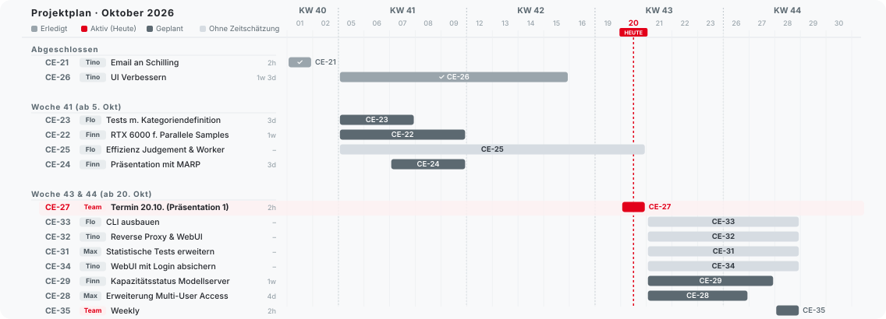
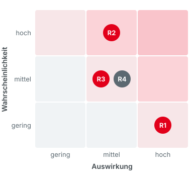
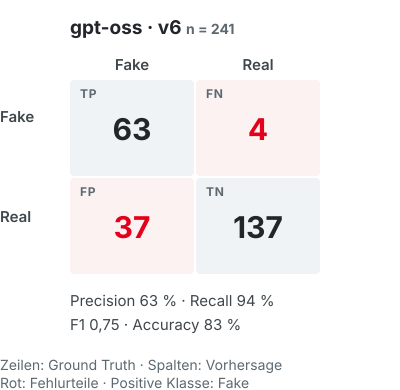
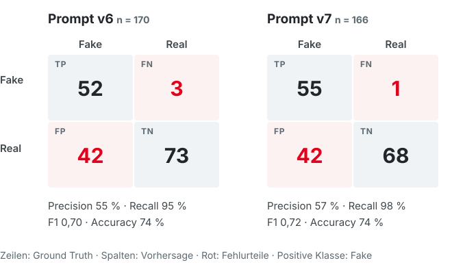
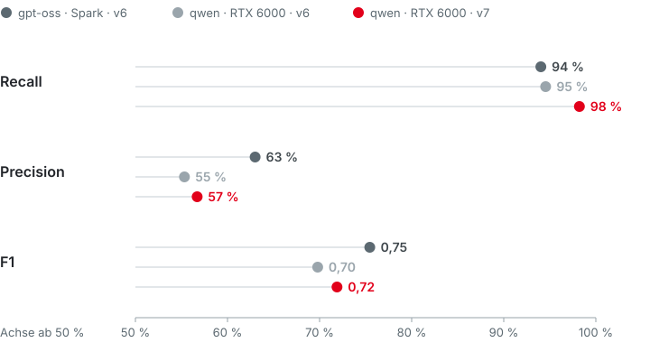
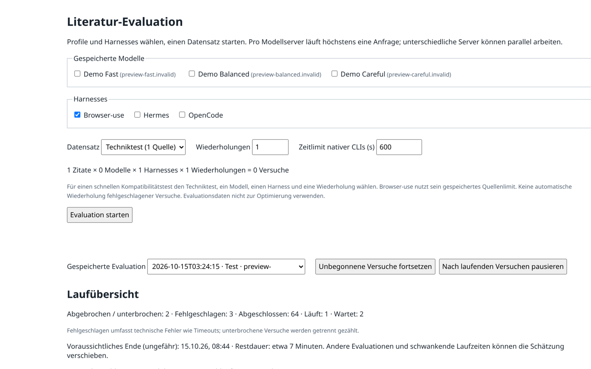
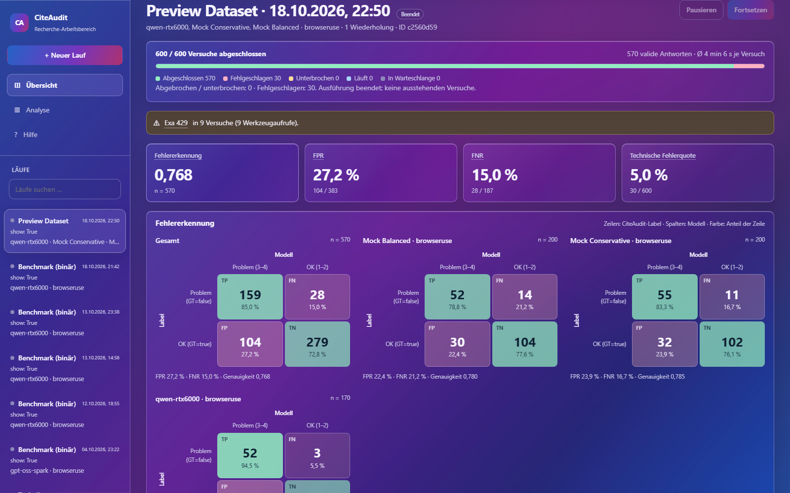
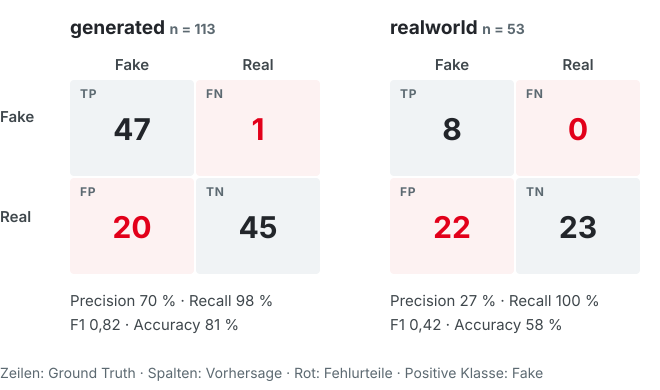

<!-- _class: title -->
<!-- _paginate: false -->

# Citation Evaluation
## KI-Agenten prüfen Literaturangaben

<strong>Team</strong>Finn Hertsch · Tino Strasser Maximilian Vogt · Florian Dittmann

<strong>Product Owner</strong>Prof. Dr. Andreas Schilling

<strong>Sprint 1</strong>DSKI · WDS124 / WDS224 20.10.2026

---

###### Überblick
# Agenda

01Projektmanagement

04Neue Kategoriendefinition

02Benchmark & Bewertung

05Ergebnis-UI

03Ergebnisse

06Ausblick

---

###### 01 · Projektstand
# Kanban-Board

Backlog 7

<b>CE-30</b>DSGVO & Recht

<b>CE-31</b>Statistische Tests

<b>CE-33</b>CLI ausbauen

<b>CE-28</b>Multi-User-Zugriff

<b>CE-29</b>Status Modellserver

<b>CE-34</b>WebUI mit Login

<b>CE-32</b>WebUI statt SSH

To Do 0

In Arbeit 3

<b>CE-25 Maximilian</b>Judgement Calls & parallele Worker

<b>CE-23 Florian</b>Neue Kategoriendefinition testen

<b>CE-22 Finn</b>RTX 6000 für parallele Samples

In Review 1

<b>CE-24 Finn</b>Präsentation mit Marp

Erledigt 2

<b>CE-21 Tino</b>Rechenleistung angefragt

<b>CE-26 Tino</b>Ergebnis-UI verbessern

---

###### 01 · Zeitplan
# Projektplan (Oktober 2026)

---

###### 01 · Risikomanagement
# Risiken früh sehen, nicht erst im Ergebnis

| | Risiko | Strategie | Maßnahme |
| :--- | :--- | :--- | :--- |
| **R1** | **Server fällt unbemerkt aus** (Spark 2× überhitzt) | Vermeiden | Läufe auf RTX 6000 (CE-22), Kapazitätsstatus (CE-29) |
| **R2** | **Viele Fehlalarme** | Vermindern | Fehlfälle analysieren, Prompt nachschärfen |
| **R3** | **Technische Ausfälle** | Vermindern | Worker stabilisieren, Resume testen |
| **R4** | **Bot-Erkennung**, Rate-Limits | Akzeptieren | Backoff, Fehler protokollieren |

---

###### 02 · Benchmark
# CiteAudit: 9.442 gelabelte Zitate

9.442

Zitate, Label Real / Fake

31 %

davon Fake

> Die Fake-Quote unterscheidet sich je Gruppe stark, deshalb werten wir **je `source_type`** aus.

---

###### 02 · Bewertung
# Vier Status, zwei Klassen

| | Status | Binär |
| :---: | :--- | :--- |
| 1 | korrekt | Real |
| 2 | nur Formfehler | Real |
| 3 | Inhaltsfehler | Fake |
| 4 | nicht verifizierbar | Fake |

<strong>Fake</strong> ist die positive Klasse: Precision, Recall, F1

<strong>Status 4</strong> heißt „nicht gefunden“, nicht „bewiesen falsch“

<strong>Timeouts</strong> zählen getrennt, nie als Fake

---

###### 03 · Laufzeit
# Ein Vollauf dauert sequentiell gut zwei Wochen

~150 s

pro Zitat

gemessen: 157 s Median (gpt-oss)

~16 Tage

für 9.442 Zitate

mit nur einem Worker

4 Stufen

bis zum Vollauf

erst skalieren, wenn valide

50

Smoke-Test

200 – 500

Pilot

5.000

Skalierung

9.442

Vollauf

---

###### 03 · Erster Lauf
# DGX Spark: Vollauf geplant, 241 Zitate geschafft

Ziel war ein <strong>Vollauf</strong> über alle 9.442 Zitate mit <strong>gpt-oss</strong> auf der <strong>DGX Spark</strong>.

Die Spark ist <strong>zweimal überhitzt</strong> – und wir haben es jeweils <strong>viel zu spät</strong> bemerkt.

Übrig blieben <strong>241 Zitate</strong>: ein erster Anhaltspunkt, kein Endergebnis.

---

###### 04 · Kategoriendefinition
# v6 nennt Fehlertypen, v7 stellt eine Prüffrage

### v6 · zwei Typenlisten

<strong>Status 2:</strong> Tippfehler, Formatierung, Groß-/Kleinschreibung

<strong>Status 3:</strong> Autorname falsch, Jahr, URL-Domain, fehlende Metadaten

Überschneidung: Ist ein Tippfehler im Autornamen ein Tippfehler oder ein falscher Autorname?

### v7 · Form oder Inhalt?

Verschwindet der Fehler, wenn Schreibweise, Leerzeichen, Interpunktion und Zitierstil ignoriert werden?

<strong>Ja → 2 Formfehler · Nein → 3 Inhaltsfehler</strong>

Der schwerste Fehler bestimmt den Status, nicht die Anzahl.

| Beispiel | v6 | v7 |
| :--- | :---: | :---: |
| „Sennnrich“ statt „Sennrich“ | 2 oder 3 | **3** |
| Falsche Autorenreihenfolge | unklar | **3** |
| Titel anders groß/klein geschrieben | 2 | **2** |

---

###### 04 · Vergleich v6 → v7
# v7 erkennt mehr Fakes – die Fehlalarme bleiben

qwen · RTX 6000 · Browser-use · dieselben 200 Zitate · v6: 18.10., v7: 13.10.2026

---

###### 04 · Vergleich
# gpt-oss ist präziser, qwen findet mehr Fakes

160 s

gpt-oss pro Zitat

DGX Spark

~240 s

qwen pro Zitat

RTX 6000

Alle mit Browser-use. gpt-oss lief auf einer <strong>anderen Stichprobe</strong>, also nur grob vergleichbar.

---

###### 05 · Ergebnis-UI
# Vorher / Nachher

Vorher

<strong>Formular · Tabelle</strong>

Nachher

<strong>Dashboard · Analyse</strong>Mock-Werte

---

###### 05 · Ergebnis-UI
# Live-Demo

Preview Dataset Mock-Werte

<a href="http://127.0.0.1:8765/#run=preview-synthetic-evaluation&amp;view=statistics&amp;metric=generation_seconds&amp;chart=box&amp;unit=case" target="_blank" rel="noopener noreferrer" style="font-size: 20px; font-weight: 700;">Browser öffnen ↗</a>

<iframe src="http://127.0.0.1:8765/#run=preview-synthetic-evaluation&amp;view=statistics&amp;metric=generation_seconds&amp;chart=box&amp;unit=case" title="Live-Demo: Preview Dataset mit gekennzeichneten Mock-Werten" sandbox="allow-scripts allow-same-origin allow-downloads" loading="lazy" style="display: block; width: 1136px; height: 396px; border: 0;"></iframe>

---

###### 06 · Ausblick
# Nächste Schritte

01 · Dringend

Spark-Ausfälle ausschließen

Überhitzung verhindern, GPU-Monitoring & RTX 6000 (CE-22, CE-29)

02

Fehlalarme senken

42 False Positives analysieren, Prompt nachschärfen

03

Skalieren

RTX 6000, parallele Worker, 5.000 Zitate

04

Zugriff

WebUI mit Login statt SSH (CE-32, CE-34)

---

<!-- _class: end -->
<!-- _paginate: false -->

# Danke!
## Fragen & Diskussion

<strong>Team</strong>Finn Hertsch · Tino Strasser Maximilian Vogt · Florian Dittmann

<strong>Repo</strong>github.com/FlorianDitt/citation-evaluation

---

<!-- _class: chapter -->
<!-- _paginate: false -->

Backup

# Backup-Folien

---

<!-- frontend-ui-status:start -->
###### Backup · Frontend
# UI-Stand

Umgesetzt

Navigation · Runs · Filter

Themes · Sprachen

Mobil · Tastatur

Statistiken · Diagramme

Vergleiche · Quantile

Tokens · Thinking · Kosten

CSV · JSON · SVG

Hinterlegt / vorbereitet

Konten · Rechte

Limits · Fair Queue

API-Verträge

Mock-Daten · Thinking

<strong>Frontend vorbereitet</strong>

Fehlt

Login · Sitzungen

Konten-Persistenz

Quoten · Fair Queue

Live-Modellstatus

<strong>Backend offen</strong> Multiuser · Live-Status

---

<!-- frontend-ui-status:end -->
<!-- frontend-ui-functions:start -->
###### Backup · Frontend
# UI-Funktionen

<h3>Laufverwaltung</h3>
Modelle · Agenten · Datensatz 
Binärmodus · Wiederholungen · Timeout 
Start · Pause · Fortsetzen · Ausblenden 
Suche · Laufwahl · Fortschritt · Restzeit

<h3>Ergebnisansicht</h3>
Modell-/Agenten-/Statusfilter 
Suche · Sortierung · Filter zurücksetzen 
Fehlerdetails · Antwort · Referenz 
Rohdaten · JSON-Vergleich · Messwerte

<h3>Qualitätskennzahlen</h3>
Status · Autor · Titel · Jahr · Fehlerzahl 
Accuracy · Präzision · Recall · F1 
FPR · FNR · technische Fehler 
Balanced Accuracy · MCC · Kappa

<h3>Statistik &amp; Vergleiche</h3>
Mittelwert · Median · Quantile · IQR 
Konfidenzintervalle · Messabdeckung 
Paar-/Mehrfachtests · Effektgrößen 
Pearson · Spearman · Holm-Korrektur

<h3>Diagramme</h3>
Boxplot · Histogramm · ECDF 
Outcomes · Matrix · Scatter · Timeline 
Paare · Forest · Differenzen 
Richtung · Quantile

<h3>Ressourcen &amp; Nutzung</h3>
Adapter · Queue · Generation · Tokens/s 
Input · Output · Thinking · Kosten 
Exa-Limits · Mock-Kennzeichnung 
Nutzung je Lauf/Modell · alle Läufe

<h3>Darstellung &amp; Bedienung</h3>
Hell · Dunkel · Pink Glass · System 
Liquid Glass · Animationen · 4 Sprachen 
Mobil · Tastatur · reduzierte Bewegung 
Hilfe · Verbindungsstatus · Wiederholen

<h3>Export &amp; Konfiguration</h3>
CSV · JSON · SVG · Direktlinks 
Diagrammfilter · Beobachtungseinheit 
Konfidenzniveau · Parallelität · Seed 
Docker-Worker · Tokenpreise

<h3>Vorbereitet · Backend offen</h3>
Profil · Login · Sitzungen · Rollen 
Nutzerverwaltung · Datenschutzaktionen 
Limits · Quoten · Fair Queue 
Live-Modellstatus

---

<!-- frontend-ui-functions:end -->
###### Backup · System
# Die Ground Truth verlässt den Evaluator nie

<strong>Lokal</strong> auf DHBW-GPUs (RTX 6000, DGX Spark)

<strong>3 Agenten:</strong> Browser-use, Hermes, OpenCode

<strong>600 s</strong> Timeout, Läufe fortsetzbar

---

###### Backup · Problem & Ziel
# KI erfindet Quellen – wir prüfen sie automatisch

### Problem
Falsche Titel, Autor:innen, Jahre und DOIs fallen beim Lesen kaum auf.

### Ansatz
Ein Agent sucht jede Quelle im Web, ein **lokales LLM** bewertet die Treffer.

### Ziel
Qualität und Laufzeit **reproduzierbar** am CiteAudit-Benchmark messen.

> Wir prüfen, ob eine Quelle **existiert und korrekt zitiert** ist, nicht ob sie die Aussage im Text belegt.

---

###### Backup · Fehleranalyse
# 42 Fehlalarme: Die Hälfte liegt am Agenten, nicht am Zitat

<strong>Wei et al. 2022</strong>, Chain-of-Thought: Status 4, keine Begründung – eines der meistzitierten Paper

<strong>CoQA</strong>: Agent schreibt selbst „minor form error“, vergibt aber Status 3

<strong>„Philiph H. S. Torr“</strong>: nach v7-Regel Status 3, CiteAudit sagt Real – Rubrik und Benchmark widersprechen sich

qwen · RTX 6000 · Browser-use · Prompt v7 · 13.10.2026 · 42 von 110 realen Zitaten fälschlich als Fake markiert

