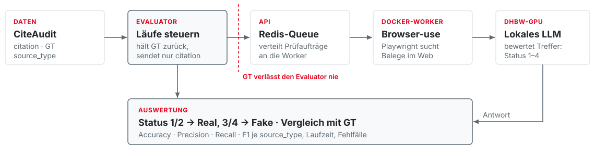
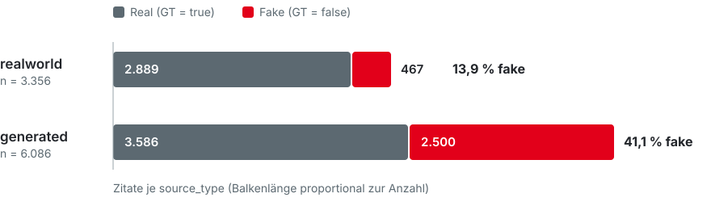
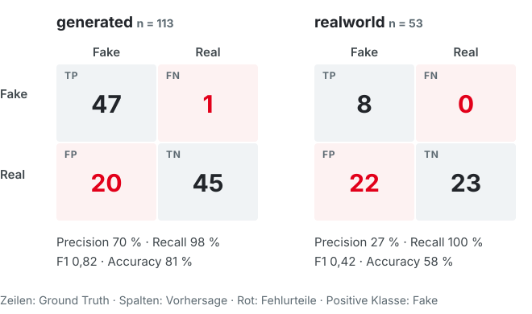
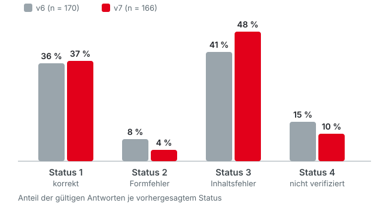

<!-- _class: title -->
<!-- _paginate: false -->

# Citation Evaluation
## KI-Agenten prüfen Literaturangaben – Projektstand Sprint 1

**Team:** Finn Hertsch, Tino Strasser, Maximilian Vogt, Florian Dittmann  
**Studiengang:** Data Science und Künstliche Intelligenz  
**Kurs:** WDS124 / WDS224 · Capstone-Project

**Product Owner:** Prof. Dr. Andreas Schilling  
**Anlass:** Präsentation 1 (Sprint 1)  
**Datum:** 20.10.2026

---

# Agenda

  

    
01

    

      <strong>Ausgangslage & Ziel</strong>
      Warum Literaturangaben automatisch prüfen?
    

  

  

    
02

    

      <strong>System & Methodik</strong>
      Datenfluss, CiteAudit-Benchmark, Bewertung
    

  

  

    
03

    

      <strong>Projektstand</strong>
      Kanban-Board und laufende Arbeiten
    

  

  

    
04

    

      <strong>Ergebnisse</strong>
      Großer Lauf, Modelle, Agenten, Kategorien
    

  

  

    
05

    

      <strong>Ergebnis-UI</strong>
      Lauf- und Statistikansicht
    

  

  

    
06

    

      <strong>Risiken & nächste Schritte</strong>
      Was bis Sprint 2 passieren muss
    

  

---

# Ausgangslage & Ziel

### Problem
* Generative KI **erfindet Quellen** oder liefert falsche Titel, Autor:innen, Venues, Jahre und DOIs.
* Diese Angaben von Hand zu prüfen kostet viel Zeit.

### Ziel
* Einen **lokal betriebenen, datenschutzkonformen** Prototyp aus einer Bachelorarbeit weiterentwickeln.
* Qualität und Laufzeit **reproduzierbar** am CiteAudit-Benchmark messen.

### Im Scope
<ul class="scope-in">
<li>Existiert die Quelle?</li>
<li>Stimmen die bibliografischen Angaben?</li>
</ul>

### Nicht im Scope
<ul class="scope-out">
<li>Belegt die Quelle die Aussage im Text?</li>
</ul>

---

# System: Datenfluss

* **Lokale Inferenz** auf DHBW-Infrastruktur (RTX 6000, DGX Spark)
* **Keine Datenleckage:** Die Ground Truth gelangt nie in Prompt oder Worker.

* **Drei Agenten im Vergleich:** Browser-use als Baseline, dazu Hermes und OpenCode.
* Läufe lassen sich pausieren und fortsetzen, mit **600 s Hard-Timeout** je Zitat.

---

# Benchmark: CiteAudit

  
9.442

  
gelabelte Zitate

  
Shi et al., binäres Label Real / Fake

  
31,4 %

  
Fake-Anteil gesamt

  
2.967 von 9.442 Zitaten

  
2 Gruppen

  
realworld und generated

  
getrennt auswerten

> Der Fake-Anteil unterscheidet sich je Gruppe um fast das Dreifache. Eine einzige Gesamt-Accuracy würde Schwächen bei **realworld** verdecken.

---

# Bewertung: vier Status, zwei Klassen

| Status | Bedeutung | Binär |
| :--- | :--- | :--- |
| **1** | bibliografisch korrekt | Real |
| **2** | nur Formfehler | Real |
| **3** | Inhaltsfehler, z. B. falsche Autor:innen | Fake |
| **4** | nicht verifizierbar | Fake |

* **Fake** ist die positive Klasse: Accuracy, Precision, Recall und F1 je `source_type`.
* Status 4 heißt **„nicht gefunden“**, nicht „bewiesen falsch“. Timeouts zählen getrennt.

### Datensätze

| Stufe | Zitate | Zweck |
| :--- | ---: | :--- |
| Techniktest | 1 | Setup |
| Test | 10 | Entwicklung |
| Evaluation | 50 | Vergleich |
| CiteAudit | 9.442 | Benchmark |

---

# Projektstand: Kanban-Board

To Do 4

<b>CE-32 · Kritisch</b>Reverse Proxy: Zugriff per WebUI statt SSH

<b>CE-34 · Hoch</b>WebUI mit Login absichern

<b>CE-22 Finn</b>RTX 6000 für parallele Samples

<b>CE-29</b>Kapazitätsstatus der Modellserver

In Arbeit 4

<b>CE-23</b>Tests mit neuer Kategoriendefinition

<b>CE-25</b>Effizientere Judgement Calls, parallele Worker

<b>CE-26 Tino</b>Ergebnis-UI verbessern

<b>CE-24 Finn</b>Präsentation mit Marp

Erledigt 1

<b>CE-21 Tino</b>Rechenleistung bei Prof. Schilling angefragt

Backlog 4

<b>CE-30</b>DSGVO und deutsches Recht

<b>CE-31</b>Statistische Tests vervollständigen

<b>CE-33</b>CLI auf WebUI-Stand bringen

<b>CE-28</b>Multi-User-Zugriff

> **Schwerpunkt:** Der Zugang wechselt von SSH zu einer abgesicherten WebUI. Erst dann können mehrere Personen gleichzeitig Läufe starten.

---

# Laufzeit: warum wir stufenweise skalieren

  

    
~147 s

    
pro Zitat

    
GPT-OSS-120B mit Browser-use (Bachelorarbeit)

  

  

    
~16 Tage

    
für 9.442 Zitate

    
bei rein sequentieller Ausführung

  

  

    
94 %

    
Statusgenauigkeit (4 Stufen)

    
Vortest mit ca. 900 Quellen, nicht repräsentativ

  

  

    
Stufe 1 · 50

    
Smoke-Test

    
Setup, Datenformat, GT-Trennung und Parser prüfen

  

  

    
Stufe 2 · 500

    
Pilot

    
Resume, Timeouts, Logs und Metriken prüfen

  

  

    
Stufe 3 · 5.000

    
Skalierung

    
Parallele Worker messen, Konfiguration einfrieren

  

  

    
Stufe 4 · 9.442

    
Vollständig

    
Nur wenn die Teilläufe valide sind

  

---

# Ergebnis: Stichprobe von 200 Zitaten (v7)

qwen-rtx6000 · Browser-use · Seed 20260911 · 13.10.2026

  
166 / 200

  
gültige Urteile

  
34 technische Ausfälle, v. a. Worker

  
98 %

  
Recall für Fake

  
55 von 56 Fakes erkannt

  
57 %

  
Precision für Fake

  
42 echte Zitate fälschlich markiert

> Fast keine Fakes entgehen dem Agenten, aber er markiert zu viel – vor allem bei **realworld**. Accuracy gesamt: **74 %**.

---

# Neue Kategoriendefinition (v7)

### Prüffrage
Verschwindet die Abweichung, wenn Groß-/Kleinschreibung, Leerzeichen, Interpunktion, Bindestriche und Zitierstil ignoriert werden?

**Ja → Formfehler → Status 2**

**Nein → Inhaltsfehler → Status 3**

* Der **schwerste** Fehler bestimmt den Status, nicht die Anzahl.
* Ab v7 hat kein Status-2-Fall mehr `GT = false`. Die Grenze passt damit zum binären Mapping.

| Abweichung | Status |
| :--- | :---: |
| Titel in anderer Groß-/Kleinschreibung | 2 |
| Leerzeichen in URL/DOI, gleiches Ziel | 2 |
| Überflüssiges „et al.“ | 2 |
| Autorname falsch, auch ein Buchstabe | 3 |
| Falsche Autorenreihenfolge | 3 |
| Autor:innen fehlen oder hinzugefügt | 3 |
| Falsches Jahr, Venue, Band, Seiten | 3 |
| URL/DOI eines anderen Werks | 3 |

---

# Vergleich: Modelle und Agenten

Platzhalter

| Modell | Agent | Accuracy | F1 (Fake) | Techn. Fehler | Ø Dauer |
| :--- | :--- | ---: | ---: | ---: | ---: |
| **[Modell A]** | Browser-use | [xx %] | [0,xx] | [x %] | [xx s] |
| | Hermes | [xx %] | [0,xx] | [x %] | [xx s] |
| | OpenCode | [xx %] | [0,xx] | [x %] | [xx s] |
| **[Modell B]** | Browser-use | [xx %] | [0,xx] | [x %] | [xx s] |
| | Hermes | [xx %] | [0,xx] | [x %] | [xx s] |
| | OpenCode | [xx %] | [0,xx] | [x %] | [xx s] |

> **Kernaussage:** [Welche Kombination schneidet am besten ab, und um wie viel?]

---

# Vergleich: Definition v6 → v7

| Kennzahl | v6 | v7 |
| :--- | ---: | ---: |
| Gültige Urteile | 241 | 166 |
| Accuracy | 83 % | 74 % |
| Recall (Fake) | 94 % | **98 %** |
| Precision (Fake) | **63 %** | 57 % |
| F1 (Fake) | **0,75** | 0,72 |
| Fakes in Status 2 | 4 | **0** |

v6: gpt-oss-spark, erste 241 Zitate · v7: qwen-rtx6000, Zufallsstichprobe

> **Status 2 ist jetzt sauber**, aber Status 3 und 4 fangen mehr echte Zitate ein. Modell und Stichprobe unterscheiden sich, daher ist das **noch kein fairer A/B-Test**. Nächster Lauf: v7 mit gpt-oss auf derselben Stichprobe.

---

# Ergebnis-UI: Statistikansicht

### Was neu ist
* Getrennte Ansichten **Lauf** und **Statistik**
* **Boxplots** für Warte- und Ausführungszeit je Konfiguration
* Wählbares **Konfidenzniveau** (90, 95 oder 99 %)
* **Worker-Steuerung** für parallele Versuche
* Designs: Hell, Dunkel, Pink Glass

  <strong>Screenshot: Statistikansicht</strong>
  Bild in assets/ ablegen

---

# Risiken

| Risiko | Auswirkung | Gegenmaßnahme |
| :--- | :--- | :--- |
| **Unscharfe Grenze Status 2/3** | Urteile schwanken, Vergleich mit CiteAudit unfair | Beispiele und Mapping mit dem Betreuer abstimmen |
| **Langer Lauf bricht ab** | Tage an Rechenzeit verloren | Stufenplan, Timeout, Resume und Checkpoints |
| **Bot-Erkennung, Rate-Limits** | fehlende Belege, Abbrüche | Fehler loggen, Backoff, klein testen |
| **Ungleiche Klassen** | Gesamt-Accuracy verdeckt Schwächen | Metriken je `source_type` berichten |
| **Lizenz des Datensatzes unklar** | Veröffentlichung nicht zulässig | Lizenz vor jeder Weitergabe klären |

---

# Nächste Schritte

  

    
Schritt 1

    
Zugriff

    
Reverse Proxy einrichten, WebUI mit Login freigeben (CE-32, CE-34)

  

  

    
Schritt 2

    
Rechenleistung

    
RTX 6000 für parallele Samples, Kapazitätsstatus sichtbar machen (CE-22, CE-29)

  

  

    
Schritt 3

    
Auswertung

    
Statistische Tests vervollständigen, CLI ausbauen (CE-31, CE-33)

  

> **Noch offen:** Status-Mapping mit dem Betreuer verbindlich festlegen. DSGVO (CE-30) und Multi-User-Zugriff (CE-28) liegen im Backlog.

---

<!-- _class: end -->
<!-- _paginate: false -->

# Vielen Dank!
## Fragen & Diskussion

<strong>Team</strong>
Finn Hertsch · Tino Strasser · Maximilian Vogt · Florian Dittmann

<strong>Projekt</strong>
Product Owner: Prof. Dr. Andreas Schilling  
Repo: github.com/FlorianDitt/citation-evaluation

