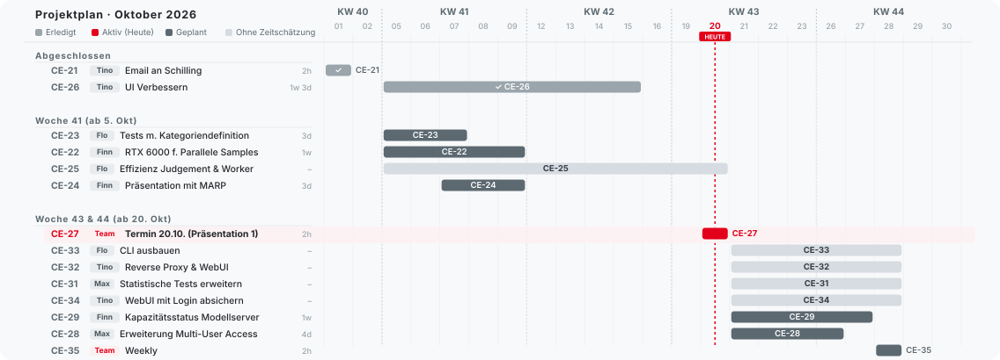
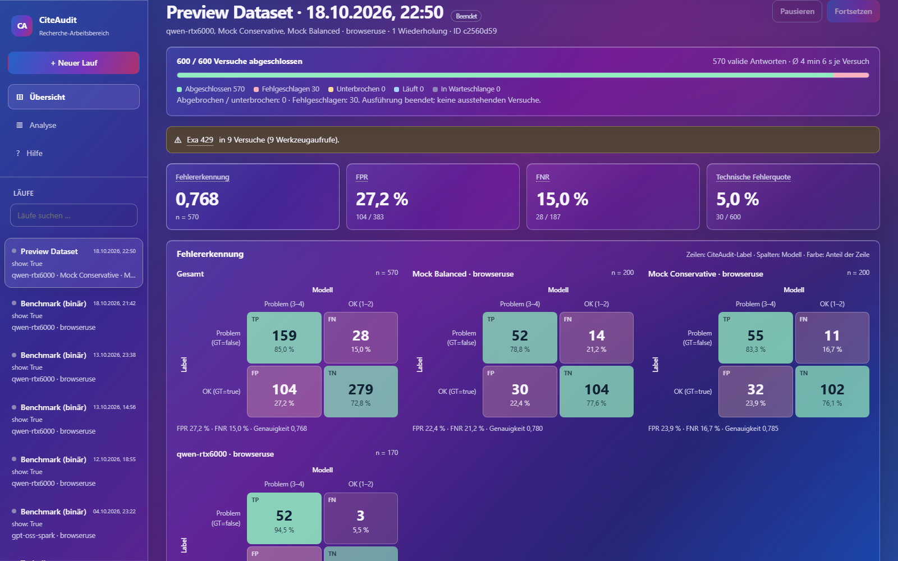
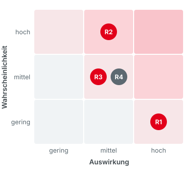
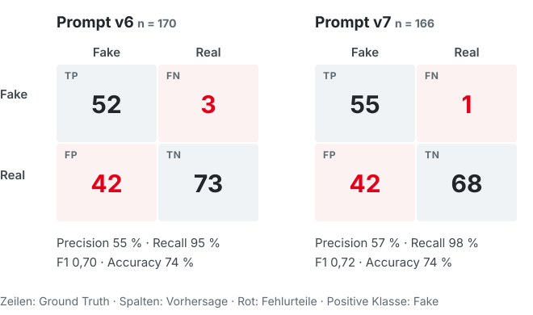
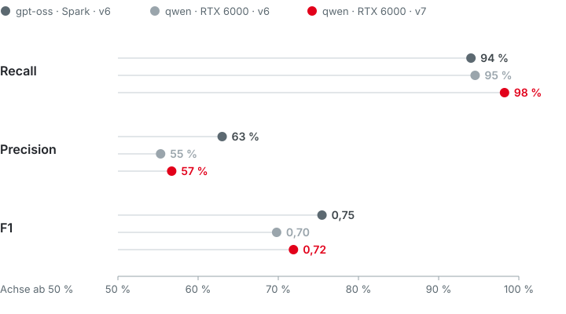

<!-- _class: title -->
<!-- _paginate: false -->

# Citation Evaluation
## KI-Agenten prüfen Literaturangaben – Meeting 2

<strong>Team</strong>Finn Hertsch, Tino Strasser Maximilian Vogt, Florian Dittmann

<strong>Product Owner</strong>Prof. Dr. Andreas Schilling

<strong>Meeting 2</strong>DSKI, WDS124 / WDS224 19.11.2026

---

###### Überblick
# Agenda

01Rückblick &amp; Projektstand

04Ergebnis-UI &amp; Demo

02Fortschritt seit Meeting 1

05Probleme &amp; Risiken

03Neue Ergebnisse

06Ausblick &amp; Nächste Schritte

---

###### 01, Rückblick
# Wo wir in Meeting 1 standen

9.442

CiteAudit-Zitate

Label Real / Fake, 31 % Fake

241

Zitate im ersten Lauf

DGX Spark, danach Überhitzung

v7

Neue Kategoriendefinition

Form- oder Inhaltsfehler?

> Ausgangspunkt für heute: **Spark-Ausfälle ausschließen, Fehlalarme senken, skalieren.**

---

###### 01, Projektstand
# Kanban-Board

**TODO: Aktuelles Board eintragen**

Backlog, To Do, In Arbeit, In Review, Erledigt – Stand zum Meeting 2

Vorlage aus Meeting 1: 5 Spalten (Backlog / To Do / In Arbeit / In Review / Erledigt) mit CE-Nummern und Zuständigkeiten.

---

###### 01, Zeitplan
# Projektplan

TODO: Gantt bei Bedarf aktualisieren (scripts/generate_gantt.py) und Meilenstein für Meeting 2 markieren.

---

###### 02, Fortschritt seit Meeting 1
# Was seit dem letzten Meeting passiert ist

01

Spark-Ausfälle ausschließen

TODO: GPU-Monitoring &amp; RTX 6000 (CE-22, CE-29) – Ergebnis eintragen

02

Fehlalarme senken

Noch offen: 1.031 FP (16,1 % der unauffälligen Zitate) in Run 1 – Analyse auf der Fehlerfolie

03

Skalieren

Erreicht: Run 1 mit 9.354 Versuchen statt 200–241 in Meeting 1 (Evaluation db5213ce)

04

Zugriff

TODO: WebUI mit Login statt SSH (CE-32, CE-34) – Stand eintragen

---

###### 03, Neue Ergebnisse
# Run 1: nahezu der gesamte Benchmark

9.354

Versuche in Run 1

Evaluation db5213ce, von 9.442 CiteAudit-Zitaten

0,82

F1 (Problem = positiv)

Precision 73,0 %, Recall 94,8 %, Accuracy 87,4 %

<strong>Recall 94,8 %</strong>, aber <strong>1.031 Fehlalarme</strong> – Precision bleibt die Baustelle.

<iframe src="../data/citation-confusion-matrix/index.html" title="Interaktive Konfusionsmatrix, Run 1" style="display:block; width:100%; height:460px; border:0;"></iframe>

---

###### 03, Fehleranalyse
# Fehlalarme dominieren – verpasste Probleme sind selten

### 1.031 False Positives, 16,1 %

Häufigste Modell-Fehlereinträge bei FP: <strong>Title mismatch</strong> (51×), <strong>Wrong publication year</strong> (37×), <strong>Author name mismatch</strong> (36×). Dazu blockierte Quellen (Captcha) als „nicht verifizierbar“.

### Nur 152 False Negatives, 5,2 %

Übersehene Probleme sind meist subtile Autorenabweichungen (Initialen, Namenszusätze). Bei TP führen dieselben Kategorien: Autor (114×), Titel (100×), Jahr (92×).

Groß-/Kleinschreibung im Titel taucht v. a. bei korrekten Zitaten auf (TN: 155× + 84× + 51×) – ein Formthema, das nicht als Inhaltsfehler zählen darf (v7-Regel). Alle Fehlertexte: Modellausgaben aus <code>answer_json</code>, nicht verifizierte Gold-Kategorien.

---

###### 03, Vergleich
# Vergleich zu Meeting 1

| Kennzahl | Meeting 1 (Pilot) | Meeting 2 (Run 1) |
| :--- | :---: | :---: |
| Stichprobe | 166–241 Zitate | **9.354 Versuche** |
| Beste Precision | 63 % (gpt-oss, Spark, v6) | **73,0 %** |
| Recall | 94–98 % | **94,8 %** |
| F1 | 0,72–0,75 | **0,82** |
| Accuracy | 74–83 % | **87,4 %** |

Achtung, nur grob vergleichbar: Meeting 1 = Fake/Real auf Pilot-Stichproben (qwen v7: n = 166, F1 0,72), Run 1 = Problem/kein Problem auf fast dem gesamten Benchmark. Der Sprung kommt v. a. aus der größeren, anders zusammengesetzten Stichprobe – nicht als reiner Modellgewinn lesen.

---

###### 04, Ergebnis-UI
# Ergebnis-UI: Stand &amp; Demo

Meeting 1

<strong>Dashboard, Analyse</strong>

Meeting 2, TODO: Screenshot austauschen

Neuen Screenshot hier einfügen assets/ui-*.png

<strong>TODO: Was ist neu?</strong>

---

###### 05, Probleme &amp; Risiken
# Was uns aktuell bremst

| | Risiko / Problem | Maßnahme |
| :--- | :--- | :--- |
| **R1** | **Server fällt unbemerkt aus** | TODO: Monitoring-Stand (CE-29) |
| **R2** | **Viele Fehlalarme** (1.031 FP, 16,1 %) | Titel-/Jahr-/Autoren-Checks schärfen, Formfehler (Großschreibung) konsequent als Status 2 werten |
| **R3** | **Blockierte Quellen** (Captcha, z. B. ScienceDirect) | Als „nicht verifizierbar“ getrennt ausweisen, nicht als Fake zählen; Backoff/Retry |
| **R4** | **Bot-Erkennung, Rate-Limits** | Backoff, Fehler protokollieren |

---

###### 06, Ausblick
# Nächste Schritte

01, Dringend

Fehlalarme senken

1.031 FP angehen: Titel-, Jahr- und Autorenabgleich schärfen, Precision über 73,0 % heben

02

Restabdeckung klären

9.354 von 9.442 Zitaten ausgewertet – verbleibende 88 Versuche abschließen

03

FN-Fälle prüfen

152 übersehene Probleme sichten (v. a. Autoren-Initialen), Recall bei 94,8 % halten

04

Zugriff &amp; Monitoring

TODO: WebUI mit Login statt SSH (CE-32, CE-34), GPU-Monitoring (CE-29) – Stand eintragen

---

<!-- _class: end -->
<!-- _paginate: false -->

# Danke!
## Fragen & Diskussion

<strong>Team</strong>Finn Hertsch, Tino Strasser Maximilian Vogt, Florian Dittmann

<strong>Repo</strong>github.com/FlorianDitt/citation-evaluation

---

<!-- _class: chapter -->
<!-- _paginate: false -->

Backup

# Backup-Folien

---

###### Backup
# Pilot-Ergebnisse aus Meeting 1

Meeting 1, Pilot-Stichproben: v6 → v7 hob den Recall (95 % → 98 %), die FP blieben bei 42. Run 1 (n = 9.354) ist damit nur grob vergleichbar.

