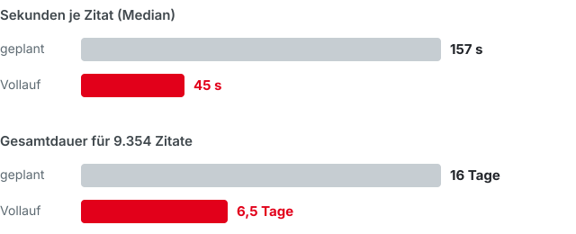
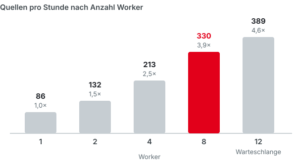
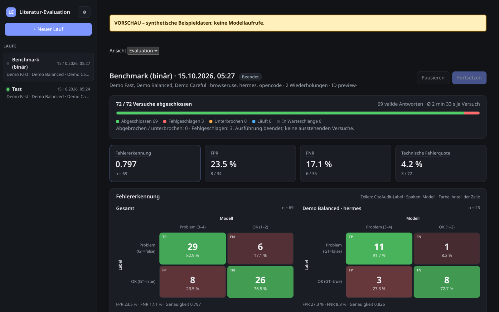

<!-- _class: title -->
<!-- _paginate: false -->

# Citation Evaluation
## Prompt v7.2 und der erste Lauf auf der RTX 6000

<strong>Team</strong>Finn Hertsch · Tino Strasser Maximilian Vogt · Florian Dittmann

<strong>Product Owner</strong>Prof. Dr. Andreas Schilling

<strong>Sprint 2</strong>DSKI · WDS124 / WDS224 19.11.2026

---

###### Überblick
# Agenda

01Projektstand

04Fehlalarme & Prompt v7.2

02RTX 6000 & Laufzeit

05Ergebnis-UI

03Läufe v7.1, v7.2 und Vollauf

06Ausblick

---

###### 01 · Projektstand · letztes Mal
# Wo wir bei der letzten Präsentation standen

Backlog 7

<b>CE-30</b>DSGVO & Recht

<b>CE-31</b>Statistische Tests

<b>CE-33</b>CLI ausbauen

<b>CE-28</b>Multi-User-Zugriff

<b>CE-29</b>Status Modellserver

<b>CE-34</b>WebUI mit Login

<b>CE-32</b>WebUI statt SSH

To Do 0

In Arbeit 3

<b>CE-25 Maximilian</b>Judgement Calls & parallele Worker

<b>CE-23 Florian</b>Neue Kategoriendefinition testen

<b>CE-22 Finn</b>RTX 6000 für parallele Samples

In Review 1

<b>CE-24 Finn</b>Präsentation mit Marp

Erledigt 2

<b>CE-21 Tino</b>Rechenleistung angefragt

<b>CE-26 Tino</b>Ergebnis-UI verbessern

Snapshot aus der letzten Präsentation — Status und Aufgaben wie damals übernommen.

---

###### 01 · Projektstand · jetzt
# Vollauf abgeschlossen, Analyse läuft weiter

Backlog 6

<b>CE-30</b>DSGVO & Recht

<b>CE-31</b>Statistische Tests

<b>CE-33</b>CLI ausbauen

<b>CE-28</b>Multi-User-Zugriff

<b>CE-34</b>WebUI mit Login

<b>CE-32</b>WebUI statt SSH

To Do 0

In Arbeit 2

<b>CE-25</b>Judgement Calls & parallele Worker

<b>CE-24</b>Präsentation mit Marp

In Review 0

Erledigt 7

<b>CE-21</b>Rechenleistung angefragt

<b>CE-22</b>RTX 6000 für Vollauf genutzt

<b>CE-23</b>Kategoriendefinition v7.2 getestet

<b>CE-26</b>Ergebnis-UI verbessert

<b>CE-29</b>Modellserver im Vollauf stabil

<b>Vollauf</b>9.354 Antworten, 0 fatale Fehler

<b>Bugfix</b>Chromium-Zombieprozesse behoben

Offen bleiben insbesondere die statistische Auswertung und die noch geplanten Zugriffs-/CLI-Funktionen. Run 2 liegt hier aggregiert vor, nicht als Einzelfalldatensatz.

---

###### 02 · Hardware
# Läufe auf der RTX 6000 statt auf der Spark

9.354 / 9.354

gültige Antworten je Vollauf

0 fatale Fehler · Chromium-Zombieprozesse behoben

2

Vollläufe mit je 9.354 Zitaten

Run 1 mit Prompt v6 · Run 2 mit v7.2

gpt-oss-120b

auf dem RTX6000-Server

Browser-use · 600 s Timeout je Zitat

> Die Spark-Ausfälle sind kein Risiko mehr: **Beide Vollläufe** liefen auf der RTX 6000 durch.

---

###### 02 · Laufzeit
# Vollauf in 6,5 Tagen statt 16

45 s

Median je Zitat

geplant: 157 s

≈ 3×

RTX 6000 statt Spark

schnellerer Modellserver

−10 bis −17 %

Judges aus

gleiches Ergebnis, weniger LLM-Calls

> Zwei Gründe: **schnellerer Server** und **Judges aus**. Ein Worker, noch ohne Parallelität.

Run 1 · gpt-oss-120b · Browser-use · Prompt v6 · n = 9.354 · 02.–09.11.2026 · Run 2 (v7.2): Median 51 s · Faktor 3× zur Spark grob (anderer Split, Codestand, Hardware)

<!--
- Geplant hatten wir 16 Tage, gerechnet mit 157 s je Zitat auf der Spark.
- Der Vollauf mit 9.354 Zitaten hat 6,5 Tage gedauert, im Median 45 s je Zitat.
- Warum kürzer? Zwei Gründe, beide in den Vollläufen aktiv:
  - Schnellerer Server: RTX 6000 statt Spark, grob Faktor 3. Grob, weil Split, Codestand und Hardware sich unterscheiden.
  - Judges aus: spart 10 bis 17 % je Zitat, ohne das Ergebnis zu ändern. Das zeige ich auf der nächsten Folie.
- Wichtig: Beide Vollläufe liefen mit einem Worker, also noch ohne Parallelität. Dazu danach.
-->

---

###### 02 · Laufzeit · Judges
# Judges aus: gleiches Ergebnis, weniger Calls

| Mittel je Quelle, Test-Split | Qwen3.8-27B | GPT-OSS-120B |
| :--- | ---: | ---: |
| Zeit mit Judges | 63,6 s | 48,3 s |
| Zeit ohne Judges | 48,3 s | 43,5 s |
| Ersparnis gemessen | **−24 %** | **−10 %** |
| davon Judges direkt | 10,4 s | 8,0 s (16,6 %) |
| LLM-Calls | 5,0 → 2,7 | 6,1 → 4,6 |
| Qualität | unverändert | unverändert |

<strong>Was sind Judges?</strong> browser-use bewertet nach jeder Prüfung den Verlauf mit 2 zusätzlichen LLM-Calls. Unser Ergebnis ändert das nicht: <strong>bytegleiches Endergebnis</strong>.

<strong>Verworfen</strong>, weil sie Entscheidungen ändern: reasoning low (−42 %), Flash (−53 %), No-Thinking (−39 %)

Test-Split, 10 Fälle × 3 Wiederholungen · Schalter BU_DISABLE_JUDGE, BU_DISABLE_SIMPLE_JUDGE · Nebenbefund: Telemetrie von browser-use an PostHog jetzt fest aus

<!--
- Judges: browser-use macht nach jeder fertigen Prüfung zwei zusätzliche LLM-Calls, Simple Judge und Full Judge. Die bewerten nur den Verlauf, nicht die Quelle.
- Unser Ergebnis ändern sie nicht. Test mit dem echten Agenten: bytegleiches Endergebnis. Außerdem laufen sie außerhalb der Timeouts.
- Lösung: zwei Schalter. Standard ist "an", damit alte Läufe reproduzierbar bleiben.
- Achtung, andere Messgröße als auf der Folie davor: hier Mittelwert auf dem Test-Split, nicht Median im Vollauf.
- Messung: Qwen spart 24 %, GPT-OSS 10 %. Direkt gemessen kosten die Judges bei GPT-OSS 16,6 % der Zeit. Dass nur 10 % herauskamen, liegt an Zufall: In den Läufen ohne Judges waren 3 Cloudflare-Sperren.
- LLM-Calls sinken um 47 % (Qwen) bzw. 25 % (GPT-OSS).
- Andere Schalter waren schneller, ändern aber Einzelentscheidungen. Deshalb verworfen.
- Nebenbefund Datenschutz: browser-use schickte standardmäßig Zitat, URLs und Ergebnis an PostHog. Das ist jetzt fest aus.
-->

---

###### 02 · Laufzeit · Ausblick
# Noch mehr drin: 8 parallele Prüfungen, 3,9× Durchsatz

8

Requests gleichzeitig

mehr verarbeitet der Server nicht, darüber Warteschlange

85–90 %

binäre Genauigkeit bis 8 Worker

bei 12 Workern 82 %

~28 h

Hochrechnung für 9.354 Zitate

statt 105–113 h seriell mit Judges aus

> Bisher **nur getestet**, in den Vollläufen noch nicht genutzt. Sweet Spot: 8 Worker je Server.

GPT-OSS-120B auf RTX 6000 · Judges aus · je Worker-Anzahl ein Lauf · 0 HTTP-Fehler · Grenze vermutlich max_num_seqs = 8 · KV-Cache max. 13 % belegt

<!--
- Das ist der nächste Hebel, den wir bisher nur getestet haben. In den Vollläufen war er noch nicht drin.
- Gemessen mit GPT-OSS auf der RTX, Judges aus, mit 1, 2, 4, 8 und 12 Workern.
- Seriell schaffen wir 86 Quellen pro Stunde, mit 8 Workern 330, also 3,9-fach.
- Jede einzelne Prüfung wird dabei langsamer (Median 36 s auf 80 s), aber es laufen 8 gleichzeitig.
- Warum 8? Der Server verarbeitet höchstens 8 Requests gleichzeitig, vermutlich max_num_seqs = 8. Bei 12 Workern warten bis zu 4 in der Warteschlange, der längste LLM-Call liegt mit 71 s knapp am LLM-Call-Timeout von 75 s, und die Qualität fällt auf 82 %.
- Bis 8 Worker ist die Qualität stabil bei 85 bis 90 %.
- Der GPU-Speicher ist kein Engpass: KV-Cache maximal 13 % belegt.
- Hochgerechnet: ~28 h für alle 9.354 Zitate statt 105 bis 113 h seriell.
-->

---

###### 02 · Laufzeit · Nächste Schritte
# Drei Dinge vor dem 28-h-Lauf

01 · Runner

8 Worker je Server erlauben

Der Runner startet bisher nur einen Versuch je Modellserver. Änderung in runner.py, eigenes Ticket.

02 · Kontext

max_model_len ≥ 64k

Größter Prompt 27,9k Token + 4.096 Antwort ≈ 32k von 32.768. Sonst drohen Abbrüche.

03 · Drosselung

Testlauf 1–2 h mit 8 Workern

Ungetestet, ob DuckDuckGo oder Cloudflare bei ~1.000 Suchen pro Stunde drosseln.

> Danach läuft der volle CiteAudit-Lauf in **gut einem Tag** statt gut zwei Wochen.

10 Fälle × 3 Wiederholungen reichen nur für grobe Aussagen: Unterschiede unter ~15 Prozentpunkten sind nicht belegbar.

<!--
- Bevor wir den 28-h-Lauf starten, müssen drei Dinge passieren.
- Erstens der Runner: Er erlaubt aktuell nur einen Versuch pro Modellserver. Für 8 Worker braucht es eine Änderung in evaluation/app/runner.py, das wird ein eigenes Ticket.
- Zweitens die Kontextlänge: Der größte Prompt hatte 27,9k Token, mit 4.096 Antwort-Token sind das fast die vollen 32.768. Bei 9.354 Quellen sind Abbrüche wahrscheinlich, daher am RTX-Server auf mindestens 64k erhöhen.
- Drittens Drosselung: Mit 8 Workern machen wir rund 1.000 Suchen pro Stunde. Ob DuckDuckGo oder Cloudflare das über 28 h mitmachen, ist ungetestet. Deshalb vorher 1 bis 2 Stunden testen.
- Zur Einordnung: Die Messungen sind klein. Unterschiede unter etwa 15 Prozentpunkten können wir nicht belegen.
-->

---

###### 03 · Läufe
# Von 200 Zitaten zum Vollauf mit 9.354

| Lauf | Prompt | Zitate | Genauigkeit | FPR | FNR |
| :--- | :--- | ---: | ---: | ---: | ---: |
| 28.10. | v7.1 | 200 | 90,0 % | 15 % | 5 % |
| 28.10. | v7.2 | 200 | **91,5 %** | **13 %** | **4 %** |
| 29.10. – 16.11. | v7.2 | **9.354** | 88,8 % | 14,1 % | 4,8 % |

Dieselben <strong>200 Zitate</strong> in Zeile 1 und 2: v7.2 ist <strong>leicht besser</strong>

Nur <strong>2 Fälle</strong> Unterschied bei FP, 1 bei FN: statistisch noch <strong>nicht belastbar</strong>

gpt-oss-120b · RTX 6000 · Browser-use · binärer Benchmark (Fake = positive Klasse) · FPR/FNR: Falsch-positiv-/Falsch-negativ-Rate

---

###### 03 · Vollauf
# 9.354 Zitate vollständig geprüft

88,8 %

Genauigkeit

8.309 von 9.354 richtig

4,8 %

Fakes übersehen

140 von 2.937 Fakes

| | Vorhersage Fake | Vorhersage Real |
| :--- | :---: | :---: |
| **Fake** (2.937) | 2.797 | 140 |
| **Real** (6.417) | 905 | 5.512 |

> Die Fakes werden fast alle erkannt. Das Problem sind die **905 Fehlalarme** (14,1 % der echten Zitate).

Lauf fb3ebb05 · Prompt v7.2 · 18 Tage Kalenderzeit mit Pausen, rund 5,5 Tage reine Laufzeit bei einem Worker (9.354 × 51 s)

---

###### 03 · Runvergleich
# Run 2 senkt Fehlalarme bei gleicher Fallzahl

+1,5 pp

Genauigkeit

87,4 % → 88,8 %

−126

Fehlalarme (FP)

1.031 → 905

−12

übersehene Fakes (FN)

152 → 140

Beide Läufe: dieselben 9.354 case_ids. Run 1 aus attempts.csv; Run 2 aus den gemergten Vollauf-Aggregaten. Für Run 2 liegen hier keine Einzelfalldaten vor, daher kein fallweiser Signifikanztest.

---

###### 04 · Fehlalarme
# 15 Fehlalarme zeigen drei Lücken im Prompt

| Lücke | Beispiel | v7.1 | v7.2 |
| :--- | :--- | :---: | :---: |
| **Frühere Fassung** trägt Titel oder Autoren (arXiv v1, v2) | Doloriel 2025, 8 weitere Autoren in der aktuellen Fassung | 3 | **1** |
| **Proceedings- und Nachdruckjahr** | Liu et al., NeurIPS 36: Konferenzjahr 2023, Bandjahr 2024 | 3 | **1** |
| **Organisation als Autor**, fehlendes Jahr | Google Research, Med-Gemini, 2024b | 3 | **2** |
| **Mitwirkende einer Auflage** | Spirtes et al., MIT Press 2000 | 3 | **1** |
| **Gesperrte Quelle**, keine Alternative gesucht | OpenReview hinter Cloudflare | 4 | **1** |

12

Fälle mit neuer Regel

Status nach v7.2 erwartet

---

###### 04 · Prompt v7.2
# Lockerer an der Form, strenger bei der Autorenliste

### Neu in v7.2

Titel, Autoren und Reihenfolge einer <strong>früheren Fassung</strong> sind kein Fehler

<strong>Organisationen</strong> dürfen Autor von Webseiten, Datensätzen und Software sein

<strong>DBLP und Semantic Scholar</strong> vor Status 4 prüfen

### Gegenmaßnahme

Die <strong>vollständige Autorenliste</strong> muss abgeglichen werden: 5 Fälle mit Problem wurden akzeptiert, bei einem nannte das Modell nur den Erstautor

Risiko: Behauptet das Modell eine frühere Fassung ohne Beleg, steigt die Falsch-negativ-Rate.

> Auf denselben 200 Zitaten ist v7.2 leicht besser als v7.1 (91,5 % gegenüber 90,0 %). Der Vollauf zeigt: 905 Fehlalarme bleiben.

---

###### 04 · Messgrenzen
# Manchmal liegt das Modell richtig und das Label falsch

| Fall | Zitat | Modell sagt |
| :--- | :--- | :--- |
| `ca-01632` | Kaplan et al., Scaling laws, 2020 | Jeffrey Wu fehlt in der Autorenliste |
| `ca-01851` | Wu, Wang, Long, Autoformer, 2021 | Jiehui Xu fehlt in der Autorenliste |

Fehlender Autor bleibt <strong>Inhaltsfehler</strong>, auch wenn CiteAudit „Real“ sagt

Wir gleichen diese Fälle <strong>bewusst nicht aus</strong>: das Label ist vermutlich falsch

Zwei Fälle bleiben außerdem unklar: ca-03078 und ca-03060 beruhen auf Vorwissen und müssen an der Quelle bestätigt werden.

---

###### 05 · Ergebnis-UI
# Läufe verwalten, Fälle einzeln prüfen

* **Drilldown:** Anfrage, Status und Musterlösung je Zitat
* **Filter** nach FP / FN / TP / TN aus der Confusion Matrix
* **Läufe** umbenennen, löschen, fehlgeschlagene Versuche wiederholen
* **Prompt-Version** je Lauf sichtbar
* **Live-Dashboard** mit Laufzeitprognose und Export

<strong>Live-Demo</strong> → wir wechseln in die Anwendung

---

###### 06 · Ausblick
# Nächste Schritte

01 · Als Nächstes

905 Fehlalarme analysieren

Muster im Vollauf finden, Prompt nachschärfen

02

Auswertung je Quelltyp

Statistische Tests, Konfidenzintervalle, Label-Fehler im Benchmark prüfen

03

Modelle und Agenten vergleichen

Qwen3.8, Hermes, OpenCode auf denselben Zitaten

04

Zugriff

WebUI mit Login statt SSH (CE-32, CE-34)

---

<!-- _class: end -->
<!-- _paginate: false -->

# Danke!
## Fragen & Diskussion

<strong>Team</strong>Finn Hertsch · Tino Strasser Maximilian Vogt · Florian Dittmann

<strong>Repo</strong>github.com/FlorianDitt/citation-evaluation

