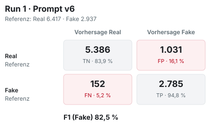
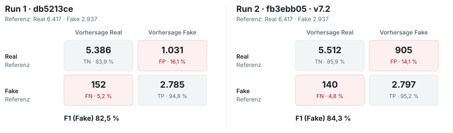

<!-- _class: title -->
<!-- _paginate: false -->

# Citation Evaluation
## Prompt v7.2 und der erste Lauf auf der RTX 6000

<strong>Team</strong>Finn Hertsch · Tino Strasser Maximilian Vogt · Florian Dittmann

<strong>Product Owner</strong>Prof. Dr. Andreas Schilling

<strong>Sprint 2</strong>DSKI · WDS124 / WDS224 19.11.2026

<!--
Einstieg: In Sprint 1 haben wir einen Prüfer gebaut und auf 200 Zitaten getestet. Heute: Was passiert, wenn er auf den ganzen Datensatz mit 9.354 Zitaten läuft? Erst die Frage, wie wir das überhaupt schaffen, dann, was dabei herauskommt.
-->

---

###### Überblick
# Agenda

01Projektstand

04Warum so viele Fehlalarme?

02RTX 6000 & Laufzeit

05Ausblick

03Läufe, Prompt v7.2 und Vergleich

---

###### 01 · Projektstand · letztes Mal
# Wo wir bei der letzten Präsentation standen

Backlog 7

<b>CE-30</b>DSGVO & Recht

<b>CE-31</b>Statistische Tests

<b>CE-33</b>CLI ausbauen

<b>CE-28</b>Multi-User-Zugriff

<b>CE-29</b>Status Modellserver

<b>CE-34</b>WebUI mit Login

<b>CE-32</b>WebUI statt SSH

To Do 0

In Arbeit 3

<b>CE-25 Maximilian</b>Judgement Calls & parallele Worker

<b>CE-23 Florian</b>Neue Kategoriendefinition testen

<b>CE-22 Finn</b>RTX 6000 für parallele Samples

In Review 1

<b>CE-24 Finn</b>Präsentation mit Marp

Erledigt 2

<b>CE-21 Tino</b>Rechenleistung angefragt

<b>CE-26 Tino</b>Ergebnis-UI verbessern

Snapshot aus der letzten Präsentation — Status und Aufgaben wie damals übernommen.

<!--
Zur Erinnerung: Stand aus Präsentation 1. Zwei Dinge waren offen, die den Vollauf bestimmen: die RTX 6000 (CE-22) und die Judgement Calls (CE-25).
-->

---

###### 01 · Projektstand · jetzt
# Vollauf abgeschlossen, Analyse läuft weiter

Backlog 8

<b>CE-30</b>DSGVO & Recht

<b>CE-31</b>Statistische Tests

<b>CE-33</b>CLI ausbauen

<b>CE-28</b>Multi-User-Zugriff

<b>CE-29</b>Status Modellserver

<b>CE-22 Finn</b>RTX 6000 für parallele Samples

<b>CE-34</b>WebUI mit Login

<b>CE-32</b>WebUI statt SSH

To Do 2

<b>CE-40</b>Modellvergleich Qwen vs. GPT vs. Deepseek

<b>CE-41</b>Open-Weights-Modelle auf RTX 6000 / DGX Spark

In Arbeit 2

<b>CE-44 Tino</b>Docker-Worker sammelt Zombie-Prozesse an

<b>CE-37 Finn</b>Kritische Prüfung der Modellwahl

In Review 0

Erledigt 10

<b>CE-38</b>Datensatz-Analyse

<b>CE-43 Tino</b>Test auf V6

<b>CE-39 Florian</b>Drilldown-Feature

<b>CE-23 Florian</b>Neue Kategoriendefinition

<b>CE-25 Maximilian</b>Judge-Calls

<b>CE-26 Tino</b>UI verbessern

<b>CE-24 Finn</b>Präsentation mit Marp

<b>CE-42 Finn</b>Slides an Schilling

<b>CE-21 Tino</b>Rechenleistung

<b>CE-36 Finn</b>Steckdose aussuchen

YouTrack, Stand 19.11.2026. Offen bleiben die statistische Auswertung, der Modellvergleich und die geplanten Zugriffs-/CLI-Funktionen.

<!--
Heute: 10 Tickets erledigt, 2 in Arbeit, 2 als Nächstes. Der Vollauf ist durch, offen ist vor allem die Auswertung. Überleitung: Wie kam es, dass der Vollauf plötzlich machbar war? Das war eine Frage der Laufzeit.
-->

---

###### 02 · Hardware
# Läufe auf der RTX 6000 statt auf der Spark

9.354 / 9.354

gültige Antworten je Vollauf

0 fatale Fehler · Chromium-Zombieprozesse behoben

2

Vollläufe mit je 9.354 Zitaten

Run 1 mit Prompt v6 · Run 2 mit v7.2

gpt-oss-120b

auf dem RTX6000-Server

Browser-use · 600 s Timeout je Zitat

> Die Spark-Ausfälle sind kein Risiko mehr: **Beide Vollläufe** liefen auf der RTX 6000 durch.

<!--
Ausgangsfrage: 9.354 Zitate mit ~150 s auf der Spark wären über 16 Tage und ein hohes Ausfallrisiko (die Spark ist zweimal überhitzt). Die RTX 6000 hat den Vollauf ohne fatalen Fehler durchgetragen. Die nächsten Folien zeigen, woher die Zeitersparnis genau kommt.
-->

---

###### 02 · Laufzeit
# Vollauf in 6,5 Tagen statt 16

45 s

Median je Zitat

geplant: 157 s

≈ 3×

RTX 6000 statt Spark

schnellerer Modellserver

−10 bis −17 %

Judges aus

gleiches Ergebnis, weniger LLM-Calls

> Zwei Gründe: **schnellerer Server** und **Judges aus**. Ein Worker, noch ohne Parallelität.

Run 1 · gpt-oss-120b · Browser-use · Prompt v6 · n = 9.354 · 02.–09.11.2026 · Run 2 (v7.2): Median 51 s · Faktor 3× zur Spark grob (anderer Split, Codestand, Hardware)

<!--
- Geplant hatten wir 16 Tage, gerechnet mit 157 s je Zitat auf der Spark.
- Der Vollauf mit 9.354 Zitaten hat 6,5 Tage gedauert, im Median 45 s je Zitat.
- Warum kürzer? Zwei Gründe, beide in den Vollläufen aktiv:
  - Schnellerer Server: RTX 6000 statt Spark, grob Faktor 3. Grob, weil Split, Codestand und Hardware sich unterscheiden.
  - Judges aus: spart 10 bis 17 % je Zitat, ohne das Ergebnis zu ändern. Das zeige ich auf der nächsten Folie.
- Wichtig: Beide Vollläufe liefen mit einem Worker, also noch ohne Parallelität. Dazu danach.
-->

---

###### 02 · Laufzeit · Judges
# Judges aus: gleiches Ergebnis, weniger Calls

| Mittel je Quelle, Test-Split | Qwen3.8-27B | GPT-OSS-120B |
| :--- | ---: | ---: |
| Zeit mit Judges | 63,6 s | 48,3 s |
| Zeit ohne Judges | 48,3 s | 43,5 s |
| Ersparnis gemessen | **−24 %** | **−10 %** |
| davon Judges direkt | 10,4 s | 8,0 s (16,6 %) |
| LLM-Calls | 5,0 → 2,7 | 6,1 → 4,6 |
| Qualität | unverändert | unverändert |

<strong>Was sind Judges?</strong> browser-use bewertet nach jeder Prüfung den Verlauf mit 2 zusätzlichen LLM-Calls. Unser Ergebnis ändert das nicht: <strong>bytegleiches Endergebnis</strong>.

<strong>Verworfen</strong>, weil sie Entscheidungen ändern: reasoning low (−42 %), Flash (−53 %), No-Thinking (−39 %)

Test-Split, 10 Fälle × 3 Wiederholungen · Schalter BU_DISABLE_JUDGE, BU_DISABLE_SIMPLE_JUDGE · Nebenbefund: Telemetrie von browser-use an PostHog jetzt fest aus

<!--
- Judges: browser-use macht nach jeder fertigen Prüfung zwei zusätzliche LLM-Calls, Simple Judge und Full Judge. Die bewerten nur den Verlauf, nicht die Quelle.
- Unser Ergebnis ändern sie nicht. Test mit dem echten Agenten: bytegleiches Endergebnis. Außerdem laufen sie außerhalb der Timeouts.
- Lösung: zwei Schalter. Standard ist "an", damit alte Läufe reproduzierbar bleiben.
- Achtung, andere Messgröße als auf der Folie davor: hier Mittelwert auf dem Test-Split, nicht Median im Vollauf.
- Messung: Qwen spart 24 %, GPT-OSS 10 %. Direkt gemessen kosten die Judges bei GPT-OSS 16,6 % der Zeit. Dass nur 10 % herauskamen, liegt an Zufall: In den Läufen ohne Judges waren 3 Cloudflare-Sperren.
- LLM-Calls sinken um 47 % (Qwen) bzw. 25 % (GPT-OSS).
- Andere Schalter waren schneller, ändern aber Einzelentscheidungen. Deshalb verworfen.
- Nebenbefund Datenschutz: browser-use schickte standardmäßig Zitat, URLs und Ergebnis an PostHog. Das ist jetzt fest aus.
-->

---

###### 02 · Laufzeit · Ausblick
# Noch mehr drin: 8 parallele Prüfungen, 3,9× Durchsatz

8

Requests gleichzeitig

mehr verarbeitet der Server nicht, darüber Warteschlange

85–90 %

binäre Genauigkeit bis 8 Worker

bei 12 Workern 82 %

~28 h

Hochrechnung für 9.354 Zitate

statt 105–113 h seriell mit Judges aus

> Bisher **nur getestet**, in den Vollläufen noch nicht genutzt. Sweet Spot: 8 Worker je Server.

GPT-OSS-120B auf RTX 6000 · Judges aus · je Worker-Anzahl ein Lauf · 0 HTTP-Fehler · Grenze vermutlich max_num_seqs = 8 · KV-Cache max. 13 % belegt

<!--
- Das ist der nächste Hebel, den wir bisher nur getestet haben. In den Vollläufen war er noch nicht drin.
- Gemessen mit GPT-OSS auf der RTX, Judges aus, mit 1, 2, 4, 8 und 12 Workern.
- Seriell schaffen wir 86 Quellen pro Stunde, mit 8 Workern 330, also 3,9-fach.
- Jede einzelne Prüfung wird dabei langsamer (Median 36 s auf 80 s), aber es laufen 8 gleichzeitig.
- Warum 8? Der Server verarbeitet höchstens 8 Requests gleichzeitig, vermutlich max_num_seqs = 8. Bei 12 Workern warten bis zu 4 in der Warteschlange, der längste LLM-Call liegt mit 71 s knapp am LLM-Call-Timeout von 75 s, und die Qualität fällt auf 82 %.
- Bis 8 Worker ist die Qualität stabil bei 85 bis 90 %.
- Der GPU-Speicher ist kein Engpass: KV-Cache maximal 13 % belegt.
- Hochgerechnet: ~28 h für alle 9.354 Zitate statt 105 bis 113 h seriell.
-->

---

###### 02 · Laufzeit · Nächste Schritte
# Drei Dinge vor dem 28-h-Lauf

01 · Runner

8 Worker je Server erlauben

Der Runner startet bisher nur einen Versuch je Modellserver. Änderung in runner.py, eigenes Ticket.

02 · Kontext

max_model_len ≥ 64k

Größter Prompt 27,9k Token + 4.096 Antwort ≈ 32k von 32.768. Sonst drohen Abbrüche.

03 · Drosselung

Testlauf 1–2 h mit 8 Workern

Ungetestet, ob DuckDuckGo oder Cloudflare bei ~1.000 Suchen pro Stunde drosseln.

> Danach läuft der volle CiteAudit-Lauf in **gut einem Tag** statt gut zwei Wochen.

10 Fälle × 3 Wiederholungen reichen nur für grobe Aussagen: Unterschiede unter ~15 Prozentpunkten sind nicht belegbar.

<!--
- Bevor wir den 28-h-Lauf starten, müssen drei Dinge passieren.
- Erstens der Runner: Er erlaubt aktuell nur einen Versuch pro Modellserver. Für 8 Worker braucht es eine Änderung in evaluation/app/runner.py, das wird ein eigenes Ticket.
- Zweitens die Kontextlänge: Der größte Prompt hatte 27,9k Token, mit 4.096 Antwort-Token sind das fast die vollen 32.768. Bei 9.354 Quellen sind Abbrüche wahrscheinlich, daher am RTX-Server auf mindestens 64k erhöhen.
- Drittens Drosselung: Mit 8 Workern machen wir rund 1.000 Suchen pro Stunde. Ob DuckDuckGo oder Cloudflare das über 28 h mitmachen, ist ungetestet. Deshalb vorher 1 bis 2 Stunden testen.
- Zur Einordnung: Die Messungen sind klein. Unterschiede unter etwa 15 Prozentpunkten können wir nicht belegen.
-->

---

###### 03 · Läufe
# Zwei Prompt-Versionen, zwei Testgrößen

### Test: 200 Zitate (28.10.)

| Prompt | Genauigkeit | FPR | FNR |
| :--- | ---: | ---: | ---: |
| v7.1 | 90,0 % | 15 % | 5 % |
| v7.2 | **91,5 %** | **13 %** | **4 %** |

<strong>Nicht belastbar:</strong> Im Saldo 2 FP und 1 FN weniger. Fallweise sind 5 FP behoben, aber 3 neu dazugekommen.

### Vollauf: 9.354 Zitate

| Lauf | Genauigkeit | FPR | FNR |
| :--- | ---: | ---: | ---: |
| Run 1 · v6 | 87,4 % | 16,1 % | 5,2 % |
| Run 2 · v7.2 | **88,8 %** | **14,1 %** | **4,8 %** |

<strong>Belastbar:</strong> Die Fehlalarme sinken signifikant (McNemar p &lt; 0,001), die übersehenen Fakes nicht.

> Der Test mit 200 Zitaten ist zu klein für eine Aussage. Tragen kann sie nur der Vergleich der Vollläufe.

gpt-oss-120b · RTX 6000 · Browser-use · Fake = positive Klasse · FPR/FNR: Falsch-positiv-/Falsch-negativ-Rate · Run 1: 02.–09.11., Run 2: 29.10.–16.11.

<!--
Zwei Prompt-Versionen, zwei Größen, und die Kästen gehören jeweils zur Tabelle darüber. Links der Test auf 200 Zitaten: v7.2 wirkt leicht besser, aber im Saldo sind es nur 2 Fehlalarme, fallweise 5 behoben und 3 neu. Das ist Rauschen. Rechts die zwei Vollläufe auf allen 9.354 Zitaten: Run 1 mit Prompt v6 ist unsere Baseline, Run 2 mit v7.2. Dort ist der Rückgang der Fehlalarme signifikant. Deshalb stützen wir uns auf die Vollläufe.
-->

---

###### 03 · Baseline
# Run 1 (Prompt v6): Fakes erkannt, aber 1.031 Fehlalarme

87,4 %

Genauigkeit

8.171 von 9.354 richtig

16,1 %

Fehlalarme (FPR)

1.031 von 6.417 echten Zitaten

5,2 %

Fakes übersehen (FNR)

152 von 2.937 Fakes

Run 1 · Prompt v6 · gpt-oss-120b · Browser-use · 02.–09.11.2026 · 5,1 Tage reine Laufzeit, Median 45 s · Fake = positive Klasse

<!--
Das ist die Baseline, mit der wir den Rest vergleichen. Run 1, Prompt v6, alle 9.354 Zitate. Von den 2.937 Fakes erkennen wir 2.785, nur 152 rutschen durch. Die Schwäche sind die 1.031 Fehlalarme: echte Zitate, die wir fälschlich als Fake markieren, 16 Prozent aller echten Zitate.
-->

---

###### 03 · Runvergleich
# Prompt v7.2 senkt die Fehlalarme von 1.031 auf 905

+1,5 pp

Genauigkeit

87,4 % → 88,8 %

−126

Fehlalarme (FP)

1.031 → 905 · McNemar p &lt; 0,001

−12

übersehene Fakes (FN)

152 → 140 · p = 0,39: nicht belegt

Dieselben 9.354 Zitate, gepaart verglichen. Fehlalarme: 424 behoben, 298 neu, 607 in beiden Läufen falsch. Übersehene Fakes: 89 behoben, 77 neu. Exakter McNemar-Test, zweiseitig.

<!--
Gleiche 9.354 Zitate, nur der Prompt ist anders, und wir haben die Einzelfälle beider Läufe. Die Genauigkeit steigt um 1,5 Prozentpunkte, die Fehlalarme sinken um 126. Gepaart (McNemar) ist das klar signifikant. Die übersehenen Fakes gehen nur um 12 zurück, das ist nicht belegbar.
Ehrlich dazu sagen: Netto sind es 126 weniger, aber dahinter stehen 424 behobene und 298 neu falsche echte Zitate. Und 607 Fehlalarme treten in beiden Läufen auf. Überleitung: Was ist zwischen Run 1 und Run 2 anders? Der Prompt. Woher kamen die Änderungen? Aus einer Handanalyse.
-->

---

###### 03 · Handanalyse
# Fünf Muster erklären 12 von 15 Fehlalarmen im Test mit 200 Zitaten

| Was der Prüfer als Fehler wertete | Warum das kein Fehler ist | Fälle | später mit v7.2 behoben |
| :--- | :--- | :---: | :---: |
| **Frühere Fassung** (arXiv v1, v2) | Dasselbe Werk, andere Version: Doloriel 2025 hat in der aktuellen Fassung 8 weitere Autoren | 6 | **2** |
| **Konferenzjahr oder Jahr des Tagungsbands** | Beide sind üblich: Liu et al., NeurIPS 36 – Konferenz 2023, Tagungsband 2024 | 2 | **1** |
| **Organisation als Autor** | Google Research (Med-Gemini) ist der Autor, keine Person | 2 | **1** |
| **Mitwirkende einer Auflage** | Spirtes et al., MIT Press 2000: weitere Mitwirkende in der Auflage | 1 | **0** |
| **Gesperrte Quelle** | OpenReview hinter Cloudflare, keine Alternative gefunden | 1 | **1** |

5 / 12

mit v7.2 behoben

3 neue Fehlalarme dazugekommen

Lauf v7.1 auf 200 Zitaten: 15 Fehlalarme, davon 12 mit diesen Mustern und 3 bewusst nicht ausgeglichen. Neu in v7.2: ca-00114, ca-02720, ca-03061.

<!--
Die Handanalyse: 15 Fehlalarme aus dem 200er-Lauf von Hand angeschaut. 12 lassen sich fünf Mustern zuordnen, bei denen der Prüfer etwas als Fehler wertet, das keiner ist. Mit v7.2 sind 5 der 12 behoben, dafür kamen 3 neue Fehlalarme dazu (Captcha, Titel ohne Untertitel, fehlender Autor). Drei weitere gleichen wir bewusst nicht aus, dazu später bei den Messgrenzen. Überleitung: Aus diesen Mustern haben wir Prompt v7.2 abgeleitet.
-->

---

###### 03 · Prompt v7.2
# Prompt v7.2: lockerer bei der Form, strenger bei der Autorenliste

### Neu in v7.2

Titel, Autoren und Reihenfolge einer <strong>früheren Fassung</strong> sind kein Fehler

<strong>Organisationen</strong> dürfen Autor von Webseiten, Blogeinträgen, Datensätzen und Software sein

<strong>DBLP und Semantic Scholar</strong> vor Status 4 prüfen

### Gegenmaßnahme

Die <strong>vollständige Autorenliste</strong> muss abgeglichen werden, damit die Lockerung keine Fakes durchlässt. Im Test mit 200 Zitaten sinken die übersehenen Fakes von 5 auf 4

> Die Regeln antworten auf die fünf Muster der Handanalyse. Im Vollauf sinken die Fehlalarme damit von 1.031 auf 905, aber nicht auf null.

<!--
Das ist der Unterschied zwischen Run 1 und Run 2, abgeleitet aus der Handanalyse. Prompt v7.2 ist lockerer bei der Form: frühere Fassungen und Organisationen als Autor sind kein Fehler, und bei gesperrten Quellen werden erst DBLP und Semantic Scholar geprüft. Als Gegenmaßnahme muss die vollständige Autorenliste abgeglichen werden, damit die Lockerung keine Fakes durchlässt. Im Test mit 200 Zitaten sinken die übersehenen Fakes von 5 auf 4.
-->

---

###### 04 · Warum so viele Fehlalarme?
# Kein Zufall: Zwei Prompts scheitern an denselben Zitaten

607

in Run 1 und Run 2 falsch

67 % der 905 Fehlalarme in Run 2

424

nur in Run 1 falsch

in Run 2 richtig

298

nur in Run 2 falsch

in Run 1 noch richtig

> Zwei verschiedene Prompts scheitern an **denselben** Zitaten. Das spricht für systematische Ursachen (Zitate, Label oder Verhalten des Modells), nicht für Zufall.

Run 1: 1.031 Fehlalarme = 607 + 424. Run 2: 905 Fehlalarme = 607 + 298. Dieselben 6.417 echten Zitate, gepaart verglichen.

<!--
Erste Antwort auf die Frage vom letzten Mal: Die Fehlalarme sind kein Zufall. 607 von 905 treten in beiden Läufen auf, mit zwei verschiedenen Prompts. Zwischen den Läufen wechseln 424 Zitate zu richtig und 298 zu falsch, netto 126 weniger.
-->

---

###### 04 · Was das Modell behauptet
# Fast immer eine konkrete Abweichung, meist in der Autorenliste

| Das Modell behauptet … | Fälle | Anteil |
| :--- | ---: | ---: |
| **Status 3 · Inhaltsfehler** | **755** | **83 %** |
| … in der Autorenliste | 396 | 44 % |
| … im Titel | 180 | 20 % |
| … im Jahr | 104 | 11 % |
| … bei Venue oder Seiten | 62 | 7 % |
| … sonstiges | 13 | 1 % |
| **Status 4 · Quelle nicht verifizierbar** | **150** | **17 %** |

83 %

behaupten einen Inhaltsfehler

755 von 905 (Status 3)

Run 2 (v7.2), 905 FP. Zuordnung automatisch nach dem zuerst genannten Stichwort in der Begründung des Modells, nicht manuell geprüft.

<!--
Was behauptet das Modell bei diesen Fehlalarmen? In 83 Prozent einen konkreten Inhaltsfehler, fast die Hälfte betrifft die Autorenliste: Reihenfolge, fehlende oder zusätzliche Autoren, abweichende Namen. Bei 150 Fällen kann es die Quelle nicht verifizieren, zum Beispiel wegen Cloudflare oder leerer Seiten.
-->

---

###### 04 · Autorenfehler
# Autorenfehler: Das Modell liest oft eine neuere Fassung

| Vorwurf bei 392 Autoren-Fehlalarmen | Fälle | Anteil |
| :--- | ---: | ---: |
| Autor fehlt im Zitat | 142 | 36 % |
| Namensvariante, Initialen | 92 | 23 % |
| Autor im Zitat, nicht in der Quelle | 79 | 20 % |
| Reihenfolge | 42 | 11 % |
| sonstiges | 37 | 9 % |

58 %

Zitat = arXiv v1

23 von 40 geprüften arXiv-Fällen (95 %: 42–72 %)

47 % / 4 %

letzte Version nach dem Snapshot

generated / realworld

> Neue Autoren seit der Erfassung erklären **nur einen Teil**: bei generated knapp die Hälfte, bei realworld kaum. Der Kern ist allgemeiner: Das Zitat gibt eine **ältere Fassung** wieder, das Modell prüft die neueste.

generated = vom LLM erzeugte Zitate, realworld = Zitate aus echten PDFs, Snapshot = CiteAudit-Stand vom 30.04.2026. Autoren-FP = erster Vorwurf betrifft die Autoren (43 % der 905), Zuordnung per Regeln. 234 von 392 haben eine arXiv-ID, 158 nicht (Journals, Bücher): dort greift Versionsdrift nicht, Ursache nicht geprüft. Stichprobe 40, Seed 1, je Fall v1 und aktuelle Fassung bei arXiv verglichen; 30 % davon sind Modellfehler. <a href="belege/versionsdrift-stichprobe.md">Alle 40 Fälle mit Links</a>.

<!--
Woher kommen die vielen Autorenfehler? Zuerst die Art: In 36 Prozent fehlt laut Modell ein Autor im Zitat, in 23 Prozent geht es um Namensvarianten, in 20 Prozent steht ein Autor im Zitat, der in der Quelle fehlt. Dann die Ursache: Wir haben 40 Fälle mit arXiv-Nummer gegen arXiv geprüft. In 23, also 58 Prozent, entspricht das Zitat genau der ersten Fassung, und die aktuelle Fassung hat andere Autoren. In 30 Prozent hat das Modell dagegen selbst unrecht.
Zur Frage, ob seit der Erfassung neue Autoren dazugekommen sind: Teilweise. Bei den generierten Zitaten hat knapp die Hälfte der Papers ihre letzte Version nach dem Snapshot vom 30. April 2026, bei den realworld-Zitaten nur 4 Prozent. Von den 23 Drift-Fällen liegt bei 8 die Überarbeitung nach dem Snapshot, bei 15 davor. Allgemeiner Kern: Das Zitat ist eine ältere Fassung.
Grenzen: Die 158 Autorenfehler ohne arXiv-Nummer sind nicht erklärt. 40 Fälle sind eine kleine Stichprobe.
-->

---

###### 04 · Stichprobe
# Von 12 geprüften Fehlalarmen lag das Modell 10-mal falsch

10 / 12

Modell falsch

8 durch Versionsdrift: Zitat = erste Fassung, das Modell prüft die neueste

1 / 12

Label falsch

zu nachsichtig (ca-02988)

1 / 12

nicht entscheidbar

ca-02260

<table style="margin-top: 6px;">
<thead><tr><th>Fall</th><th>Zitat</th><th>Label</th><th>Modell behauptet</th><th>Befund</th></tr></thead>
<tbody>
<tr><td style="white-space: nowrap;"><a href="https://arxiv.org/abs/2512.23365v1"><code>ca‑08875</code></a></td><td>Lee et al., SpatialMosaic, 2025</td><td>Real</td><td>Autorenreihenfolge falsch</td><td>Zitat = arXiv <a href="https://arxiv.org/abs/2512.23365v1">v1</a>, das Modell prüfte die aktuelle Fassung <a href="https://arxiv.org/abs/2512.23365v4">v4</a></td></tr>
<tr><td style="white-space: nowrap;"><a href="https://arxiv.org/abs/2304.06767v1"><code>ca‑02169</code></a></td><td>Dong et al., RAFT, 2023</td><td>Real</td><td>Zwei Autoren fehlen</td><td><a href="https://arxiv.org/abs/2304.06767v1">v1</a> hat 8 Autoren wie zitiert, die <a href="https://arxiv.org/abs/2304.06767">aktuelle Fassung</a> 10</td></tr>
<tr><td style="white-space: nowrap;"><a href="https://doi.org/10.1038/s41586-025-09429-6"><code>ca‑02988</code></a></td><td>Correia et al., BindCraft, 2025</td><td>Real</td><td>Band und Seiten falsch</td><td>Stimmt: <a href="https://doi.org/10.1038/s41586-025-09429-6">Nature 646, 483–492</a>, das Label ist zu nachsichtig</td></tr>
</tbody>
</table>

12 der 607 wiederkehrenden FP (Seed 1, nach Fehlerart geschichtet), je Fall per Webquelle geprüft, Belege: Backup-Folie. Label-Fehler 1/12: 95-%-Intervall 1,5–35 %.

<!--
Wir haben 12 der 607 wiederkehrenden Fehlalarme gegen die Quellen geprüft. In 10 Fällen lag das Modell falsch, in 8 davon wegen Versionsdrift: Das Zitat entspricht genau der ersten arXiv-Fassung, die später überarbeitet wurde, etwa um Autoren ergänzt. Das Modell liest die aktuelle Fassung und meldet einen Fehler. Nach unserer eigenen Regel aus v7.2 wäre das kein Fehler. Nur ein Fall ist ein echter Label-Fehler, BindCraft mit falschem Band. Ehrlich: Das sind 12 Fälle, das Intervall für den Label-Fehleranteil ist breit.
-->

---

###### 04 · Messgrenzen
# Nicht jeder Fehlalarm ist ein Modellfehler: fünf Grenzfälle

<table>
<thead><tr><th>Fall</th><th>Zitat</th><th>Label</th><th>Modell sagt</th><th>Bewertung</th></tr></thead>
<tbody>
<tr><td style="white-space: nowrap;"><a href="https://arxiv.org/abs/2001.08361"><code>ca‑01632</code></a></td><td>Kaplan et al., Scaling laws, 2020</td><td>Real</td><td>Jeffrey Wu fehlt in der Autorenliste</td><td><strong>Modell hat recht</strong>, Label vermutlich falsch</td></tr>
<tr><td style="white-space: nowrap;"><a href="https://arxiv.org/abs/2106.13008"><code>ca‑01851</code></a></td><td>Wu, Wang, Long, Autoformer, 2021</td><td>Real</td><td>Jiehui Xu fehlt in der Autorenliste</td><td><strong>Modell hat recht</strong>, Label vermutlich falsch</td></tr>
<tr><td style="white-space: nowrap;"><a href="https://doi.org/10.7551/mitpress/1754.001.0001"><code>ca‑03078</code></a></td><td>Spirtes et al., MIT Press, 2000</td><td>Real</td><td>Heckerman fehlt, Jahr 2001</td><td>Offen: laut Doku Mitwirkender der 2. Auflage, an der Quelle prüfen</td></tr>
<tr><td style="white-space: nowrap;"><a href="https://doi.org/10.1007/978-1-4471-0211-3"><code>ca‑03060</code></a></td><td>d’Avila Garcez et al., Springer, 2012</td><td>Real</td><td>Erstausgabe 2002, kein Beleg für 2012</td><td>Offen: Nachdruck 2012, an der Quelle prüfen</td></tr>
<tr><td style="white-space: nowrap;"><code>ca‑00997</code></td><td>„Revolutionizing data …“, 2024, ohne Autoren</td><td>Real</td><td>Keine passende Quelle gefunden (v7.1)</td><td>Offen: Quelle auch von uns nicht auffindbar (arXiv, Crossref)</td></tr>
</tbody>
</table>

ca-01632 und ca-01851 gleichen wir bewusst nicht aus: Ein fehlender Autor bleibt ein Inhaltsfehler, auch wenn CiteAudit „Real“ sagt.

<!--
Nicht jeder Fehlalarm ist ein Fehler des Modells. Bei den ersten zwei liegt vermutlich das Label falsch: Ein Autor fehlt tatsächlich in der Zitierung. Zwei weitere beruhen auf bibliografischem Vorwissen und müssen noch an der Quelle bestätigt werden. Beim fünften (ca-00997) haben auch wir die Quelle nicht gefunden, er bleibt offen.
-->

---

###### 05 · Ausblick
# Nächste Schritte

01 · Als Nächstes

Versionsprüfung erzwingen

Bei arXiv und bioRxiv die Versionsliste abrufen und vor Status 3 gegen v1 abgleichen (Prompt v7.3)

02

Label-Fehler belegen

Stichprobe auf 50–100 FP vergrößern, belegte Fälle als Revisionsdatei führen, Kennzahlen mit und ohne Korrektur

03

Modelle und Agenten vergleichen

Qwen3.8, Hermes, OpenCode auf denselben Zitaten, getrennt nach realworld und generated (CE-40, CE-41)

04

Zugriff

WebUI mit Login statt SSH (CE-32, CE-34)

<!--
Schluss: Wir wissen jetzt, wo der Prüfer irrt. Als Nächstes die 905 Fehlalarme systematisch auswerten und Modelle auf denselben Zitaten vergleichen. Danach Fragen.
-->

---

<!-- _class: end -->
<!-- _paginate: false -->

# Danke!
## Fragen & Diskussion

<strong>Team</strong>Finn Hertsch · Tino Strasser Maximilian Vogt · Florian Dittmann

<strong>Repo</strong>github.com/FlorianDitt/citation-evaluation

---

###### Backup · Belege Stichprobe
# Alle 12 geprüften Fehlalarme mit Quelle

| Fall | Modell behauptet | Befund | Beleg |
| :--- | :--- | :--- | :--- |
| `ca‑01252` | Penzar fehlt, Titel weicht ab | Versionsdrift | [bioRxiv v1](https://www.biorxiv.org/content/10.1101/2023.06.12.544594v1) |
| `ca‑08875` | Reihenfolge falsch | Versionsdrift | [arXiv v1](https://arxiv.org/abs/2512.23365v1) · [v4](https://arxiv.org/abs/2512.23365v4) |
| `ca‑00599` | Filippas, Manning fehlen | Versionsdrift (NBER-Erstausgabe nicht direkt belegt) | [arXiv v1](https://arxiv.org/abs/2301.07543v1) · [NBER](https://www.nber.org/papers/w31122) |
| `ca‑02169` | Zwei Autoren fehlen | Versionsdrift | [arXiv v1](https://arxiv.org/abs/2304.06767v1) · [aktuell](https://arxiv.org/abs/2304.06767) |
| `ca‑01124` | 4 Autoren fehlen | Versionsdrift | [arXiv v1](https://arxiv.org/abs/2402.01788v1) |
| `ca‑07418` | Titel weicht ab, Koautoren fehlen | Versionsdrift | [arXiv v1](https://arxiv.org/abs/2512.18542v1) |
| `ca‑08703` | Titel weicht ab | Versionsdrift | [arXiv v1](https://arxiv.org/abs/2512.22777v1) |
| `ca‑06604` | Titel weicht ab | Versionsdrift | [arXiv v1](https://arxiv.org/abs/2601.00396v1) |
| `ca‑02809` | 1995 statt 1993 | Modell falsch (Clarendon Press 1993) | [Cambridge](https://www.cambridge.org/core/journals/language-in-society/article/abs/carol-myersscotton-social-motivations-for-codeswitching-evidence-from-africa-oxford-studies-in-language-contact-oxford-clarendon-1993-pp-xii-177-hb-3500/41026149A62638461EDEDADD3EB73D8A) |
| `ca‑00765` | Gehört zu keiner Reihe | Modell falsch (Bd. 56 der Reihe Texts in Applied Mathematics) | Link nicht abrufbar |
| `ca‑02260` | 2022 statt 2023 | nicht entscheidbar | [Zenodo](https://zenodo.org/records/7421784) |
| `ca‑02988` | Band und Seiten falsch | Label zu nachsichtig | [Nature, DOI](https://doi.org/10.1038/s41586-025-09429-6) |

Selbst nachgeprüft: ca‑08875, ca‑02169, ca‑02988 (Autorenlisten und Versionen bei arXiv, Band und Seiten über Crossref). Übrige Fälle nach der Prüfung durch einen Hilfs-Agenten, die Links sind erreichbar, Inhalte nicht einzeln von mir kontrolliert.

---

###### Backup · Spark
# Die Spark überhitzt nicht mehr: Wachhund statt Dauerlast

85 °C

Pause

keine neuen Versuche

70 °C

automatisch weiter

Hysterese gegen Flackern

90 °C

Abbruch

Pause bleibt bis zur manuellen Freigabe

### Regeln

Gemessen wird die <strong>heißeste Thermal-Zone</strong>, nicht nur die GPU

Abbruch auch, wenn sich die GPU <strong>selbst drosselt</strong>

Nur <strong>ein</strong> schwerer Job gleichzeitig, erst eine <strong>10-Minuten-Probe</strong>

### In der Evaluation

Der Wachhund liest die Temperatur per SSH und <strong>pausiert die Vergabe</strong> neuer Versuche an die Spark

<strong>Mehrere Worker je Server</strong> sind einstellbar, Start mit 2 und Temperatur beobachten

Herkunft: tools/spark-thermo (BeeHive-Projekt), dort zusätzlich Bremse im Training (halbe Rechenzeit, Pause ab 75 °C). In der Evaluation steuert der Wachhund nur die Vergabe, laufende Versuche enden regulär. Temperaturmessungen vorher/nachher liegen hier nicht vor.

<!--
Backup, falls nach den Spark-Ausfällen gefragt wird. Die Spark ist zweimal überhitzt. Lösung aus dem BeeHive-Projekt: ein Wachhund misst die heißeste Thermal-Zone, pausiert ab 85 Grad, macht unter 70 Grad weiter und bricht ab 90 Grad ab. In der Evaluation ist das als Hitzeschutz in der Ablaufsteuerung eingebaut. Zusammen mit mehreren Workern je Server können wir die Spark gezielt auslasten, ohne sie zu überhitzen. Noch nicht belegt: Messwerte vorher/nachher.
-->

---

###### Backup · Metriken
# Accuracy und F1 messen Verschiedenes

### Formeln (Fake = positive Klasse)

<strong>Accuracy</strong> = <code>(TP + TN) / (TP + TN + FP + FN)</code>

<strong>Precision</strong> = <code>TP / (TP + FP)</code>

<strong>Recall</strong> = <code>TP / (TP + FN)</code>

<strong>F1</strong> = <code>2 · P · R / (P + R)</code>

= <code>2 · TP / (2 · TP + FP + FN)</code>

| | Run 1 (v6) | Run 2 (v7.2) |
| :--- | ---: | ---: |
| Accuracy | 87,4 % | 88,8 % |
| Precision | 73,0 % | 75,6 % |
| Recall | 94,8 % | 95,2 % |
| **F1** | **82,5 %** | **84,3 %** |

> Accuracy zählt auch die richtig erkannten echten Zitate (TN). F1 ignoriert sie und zeigt, wie gut die **Fakes** gefunden werden, ohne zu viele Fehlalarme.

Nur 31 % der 9.354 Zitate sind Fakes. „Immer Real“ erreicht 68,6 % Accuracy, aber F1 = 0. Die Fehlalarme (FP) senken die Precision, deshalb liegt F1 unter der Accuracy.

<!--
Accuracy ist der Anteil aller richtig klassifizierten Zitate. F1 ist das harmonische Mittel aus Precision und Recall für die Klasse Fake, die richtig erkannten echten Zitate zählen dort nicht mit. Weil nur 31 Prozent der Zitate Fakes sind, wäre "immer Real" schon 68,6 Prozent Accuracy, aber F1 null. Der niedrigere F1-Wert zeigt, dass die Fehlalarme die Precision drücken: Recall 95 Prozent, Precision 73 bis 76 Prozent.
-->

---

###### Backup · Statistik
# McNemar-Test: gepaarter Vergleich von Run 1 und Run 2

| Klasse | Run 2 behoben (b) | Run 2 neu falsch (c) | p |
| :--- | ---: | ---: | ---: |
| Fehlalarme (6.417 echte) | 424 | 298 | **&lt;&nbsp;0,001** |
| Übersehene Fakes (2.937) | 89 | 77 | 0,39 |
| Gesamt (9.354) | 513 | 375 | **&lt;&nbsp;0,001** |

### Warum McNemar?

Beide Läufe prüfen <strong>dieselben 9.354 Zitate</strong>, die Messungen sind gepaart

Nur Zitate mit geändertem Ergebnis tragen Information. Wäre der Prompt egal, wären „behoben“ und „neu falsch“ <strong>gleich häufig</strong>

Exakt: <code>p = 2 · Σi=0…min(b,c) C(b+c, i) / 2b+c</code>

Näherung: <code>χ² = (b − c)² / (b + c)</code> · Fehlalarme: χ² = 126² / 722 ≈ 22,0 (1 Freiheitsgrad)

Exakter Binomialtest, zweiseitig (p ≈ 3 · 10⁻⁶ bei den Fehlalarmen). Bonferroni (α = 0,025) ändert nichts am FP-Befund. Grenze: je Prompt nur ein Lauf, Modellrauschen nicht gemessen.

<!--
Backup, falls nach dem Signifikanztest gefragt wird. McNemar ist der passende Test, weil beide Läufe dieselben 9.354 Zitate bewerten. Wir zählen nur die Zitate, bei denen sich das Ergebnis zwischen Run 1 und Run 2 ändert. Bei den echten Zitaten sind das 424, die jetzt richtig sind, und 298, die jetzt falsch sind. Wäre der Prompt egal, müssten die beiden Zahlen etwa gleich groß sein, das testen wir mit einem exakten Binomialtest. Ergebnis: p ungefähr 3 mal 10 hoch minus 6. Bei den übersehenen Fakes 89 gegen 77, p gleich 0,39, kein belegter Unterschied.
Grenze offen nennen: Wir haben je Prompt nur einen Lauf. Wie stark ein Lauf mit demselben Prompt von selbst schwankt, haben wir nicht gemessen. Das 298-neu-falsch deutet an, dass dieses Rauschen nicht klein ist.
-->
