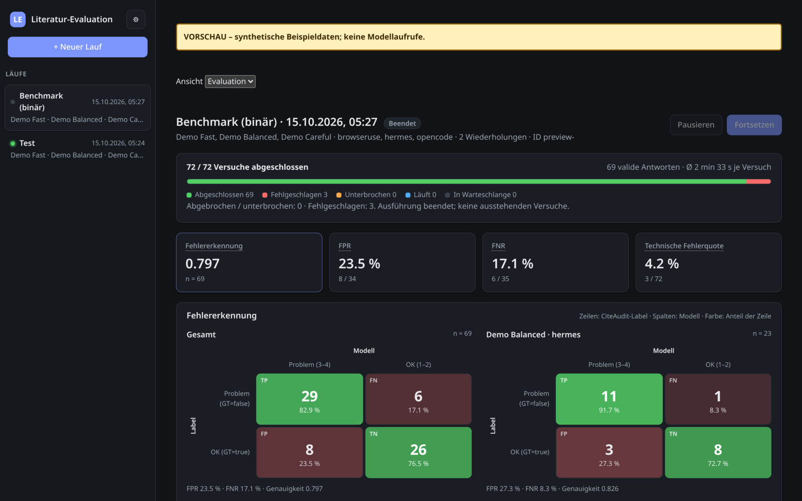
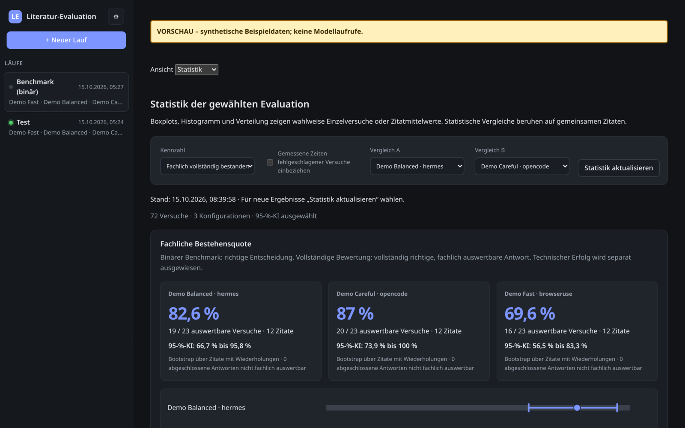

<!-- _class: title -->
<!-- _paginate: false -->

# Citation Evaluation
## KI-Agenten prüfen Literaturangaben

<strong>Team</strong>Finn Hertsch · Tino Strasser Maximilian Vogt · Florian Dittmann

<strong>Product Owner</strong>Prof. Dr. Andreas Schilling

<strong>Sprint 1</strong>DSKI · WDS124 / WDS224 20.10.2026

---

###### Überblick
# Agenda

01Problem & Ziel

04Neue Kategoriendefinition

02System & Benchmark

05Ergebnis-UI

03Ergebnisse

06Risiken & nächste Schritte

---

###### 01 · Problem & Ziel
# KI erfindet Quellen – wir prüfen sie automatisch

### Problem
Falsche Titel, Autor:innen, Jahre und DOIs fallen beim Lesen kaum auf.

### Ansatz
Ein Agent sucht jede Quelle im Web, ein **lokales LLM** bewertet die Treffer.

### Ziel
Qualität und Laufzeit **reproduzierbar** am CiteAudit-Benchmark messen.

> Wir prüfen, ob eine Quelle **existiert und korrekt zitiert** ist, nicht ob sie die Aussage im Text belegt.

---

###### 02 · System
# Die Ground Truth verlässt den Evaluator nie

<strong>Lokal</strong> auf DHBW-GPUs (RTX 6000, DGX Spark)

<strong>3 Agenten:</strong> Browser-use, Hermes, OpenCode

<strong>600 s</strong> Timeout, Läufe fortsetzbar

---

###### 02 · Benchmark
# CiteAudit: 9.442 gelabelte Zitate

9.442

Zitate, Label Real / Fake

31 %

davon Fake

> Die Fake-Quote unterscheidet sich je Gruppe stark, deshalb werten wir **je `source_type`** aus.

---

###### 02 · Bewertung
# Vier Status, zwei Klassen

| | Status | Binär |
| :---: | :--- | :--- |
| 1 | korrekt | Real |
| 2 | nur Formfehler | Real |
| 3 | Inhaltsfehler | Fake |
| 4 | nicht verifizierbar | Fake |

<strong>Fake</strong> ist die positive Klasse: Precision, Recall, F1

<strong>Status 4</strong> heißt „nicht gefunden“, nicht „bewiesen falsch“

<strong>Timeouts</strong> zählen getrennt, nie als Fake

---

###### 03 · Projektstand
# Kanban-Board

To Do 4

<b>CE-32 · KRITISCH</b>WebUI statt SSH (Reverse Proxy)

<b>CE-34 · HOCH</b>WebUI mit Login absichern

<b>CE-22 Finn</b>RTX 6000 für parallele Samples

<b>CE-29</b>Kapazitätsstatus der Modellserver

In Arbeit 4

<b>CE-23</b>Neue Kategoriendefinition testen

<b>CE-25</b>Judgement Calls & parallele Worker

<b>CE-26 Tino</b>Ergebnis-UI verbessern

<b>CE-24 Finn</b>Präsentation mit Marp

Erledigt 1

<b>CE-21 Tino</b>Rechenleistung angefragt

Backlog 4

<b>CE-30</b>DSGVO & deutsches Recht

<b>CE-31</b>Statistische Tests

<b>CE-33</b>CLI ausbauen

<b>CE-28</b>Multi-User-Zugriff

---

###### 03 · Laufzeit
# Ein Vollauf dauert sequentiell gut zwei Wochen

~150 s

pro Zitat

gemessen: 157 s Median (gpt-oss)

~16 Tage

für 9.442 Zitate

mit nur einem Worker

4 Stufen

bis zum Vollauf

erst skalieren, wenn valide

50

Smoke-Test

200 – 500

Pilot

5.000

Skalierung

9.442

Vollauf

---

###### 03 · Ergebnis
# Fast alle Fakes erkannt – aber zu viele Fehlalarme

98 %

Recall

55 von 56 Fakes

57 %

Precision

42 Fehlalarme

166 / 200

gültige Urteile

34 technische Ausfälle

Stichprobe von 200 Zitaten · qwen-rtx6000 · Browser-use · Prompt v7 · 13.10.2026

---

###### 04 · Kategoriendefinition
# Form oder Inhalt?

### Prüffrage
Verschwindet der Fehler, wenn Schreibweise, Leerzeichen, Interpunktion und Zitierstil ignoriert werden?

2&nbsp; <strong>Ja:</strong> Formfehler

3&nbsp; <strong>Nein:</strong> Inhaltsfehler

> Der **schwerste** Fehler bestimmt den Status.

| Beispiel | Status |
| :--- | :---: |
| Titel anders groß/klein geschrieben | 2 |
| Überflüssiges „et al.“ | 2 |
| Autorname falsch, auch ein Buchstabe | 3 |
| Autor:innen fehlen oder vertauscht | 3 |
| Falsches Jahr, Venue oder Seiten | 3 |
| DOI eines anderen Werks | 3 |

---

###### 04 · Vergleich v6 → v7
# Status 2 ist jetzt sauber

| | v6 | v7 |
| :--- | ---: | ---: |
| Recall | 94 % | **98 %** |
| Precision | **63 %** | 57 % |
| F1 | **0,75** | 0,72 |
| Fakes in Status 2 | 4 | **0** |

v6: gpt-oss, 241 Zitate · v7: qwen, 166 Zitate. Andere Modelle und Stichproben, also noch kein fairer A/B-Test.

---

###### 04 · Vergleich
# Modelle und Agenten

Platzhalter

| Modell | Agent | Recall | Precision | F1 | Ø Dauer |
| :--- | :--- | ---: | ---: | ---: | ---: |
| **[Modell A]** | Browser-use | [xx %] | [xx %] | [0,xx] | [xx s] |
| | Hermes | [xx %] | [xx %] | [0,xx] | [xx s] |
| | OpenCode | [xx %] | [xx %] | [0,xx] | [xx s] |
| **[Modell B]** | Browser-use | [xx %] | [xx %] | [0,xx] | [xx s] |
| | Hermes | [xx %] | [xx %] | [0,xx] | [xx s] |
| | OpenCode | [xx %] | [xx %] | [0,xx] | [xx s] |

---

###### 05 · Ergebnis-UI
# Vom Formular zum Dashboard

Vorher

Nachher

Beide Ansichten mit denselben synthetischen Vorschau-Daten, ohne Modellaufrufe.

---

###### 05 · Ergebnis-UI
# Statistik mit Konfidenzintervallen

* Läufe **vergleichen**
* **95 %-KI** per Bootstrap
* **Worker** steuern
* Hell, Dunkel, Pink Glass

---

###### 06 · Risiken
# Was uns bremsen kann

| Risiko | Gegenmaßnahme |
| :--- | :--- |
| **Viele Fehlalarme** bei realworld | Fehlfälle analysieren, Prompt nachschärfen |
| **Technische Ausfälle** (17 %) | Worker stabilisieren, Resume testen |
| **Bot-Erkennung**, Rate-Limits | Backoff, Fehler protokollieren |
| **Lizenz** des Datensatzes unklar | vor jeder Weitergabe klären |

---

###### 06 · Ausblick
# Nächste Schritte

01

Fairer A/B-Test

v6 und v7 mit gleichem Modell und gleicher Stichprobe

02

Zugriff

WebUI mit Login statt SSH (CE-32, CE-34)

03

Skalieren

RTX 6000, parallele Worker, 5.000 Zitate

---

<!-- _class: end -->
<!-- _paginate: false -->

# Danke!
## Fragen & Diskussion

<strong>Team</strong>Finn Hertsch · Tino Strasser Maximilian Vogt · Florian Dittmann

<strong>Repo</strong>github.com/FlorianDitt/citation-evaluation

